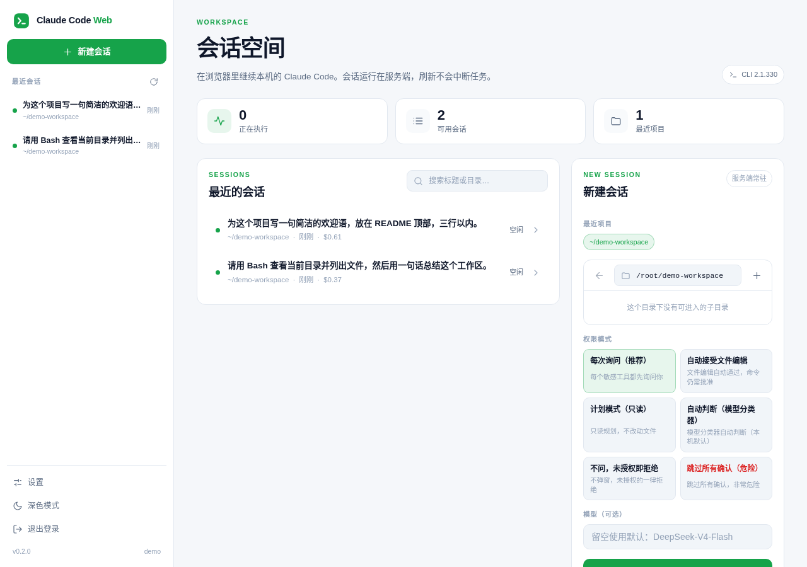
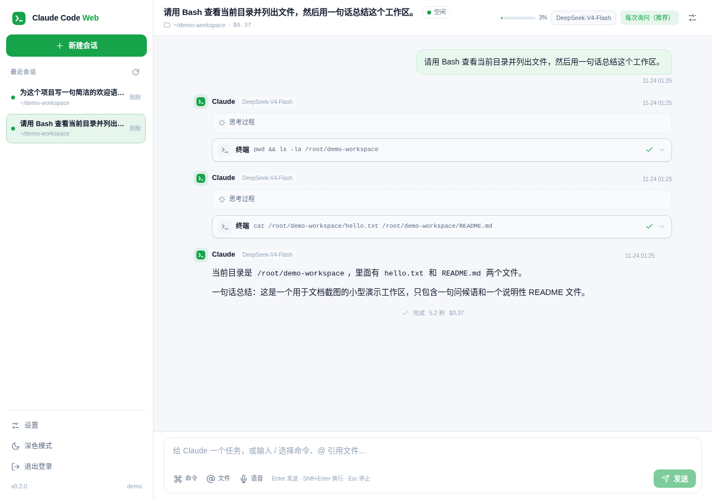
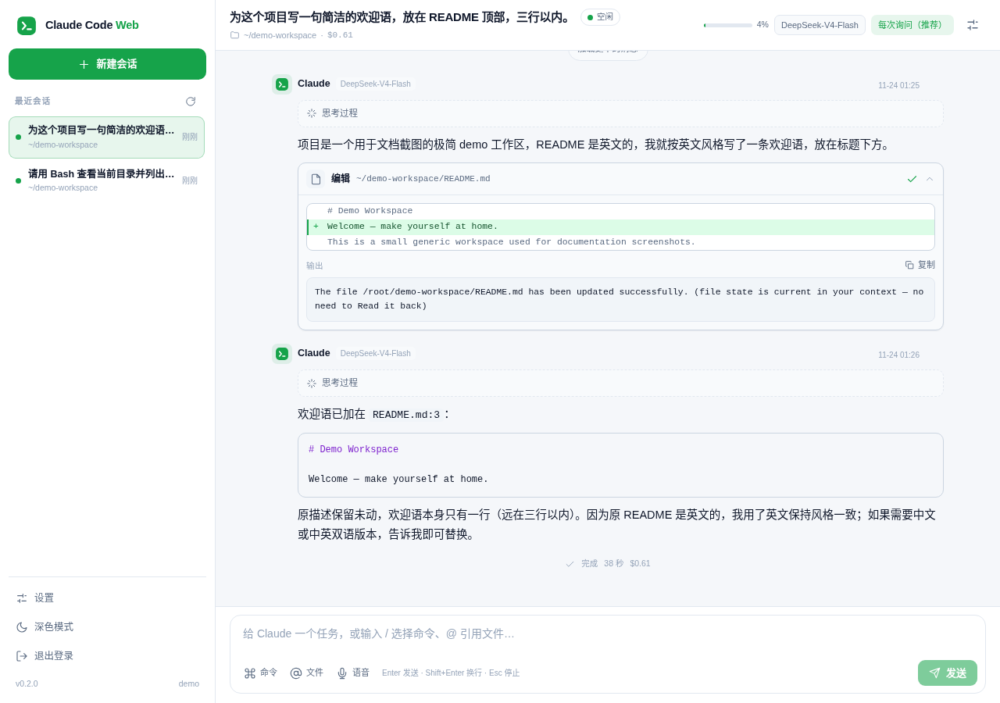
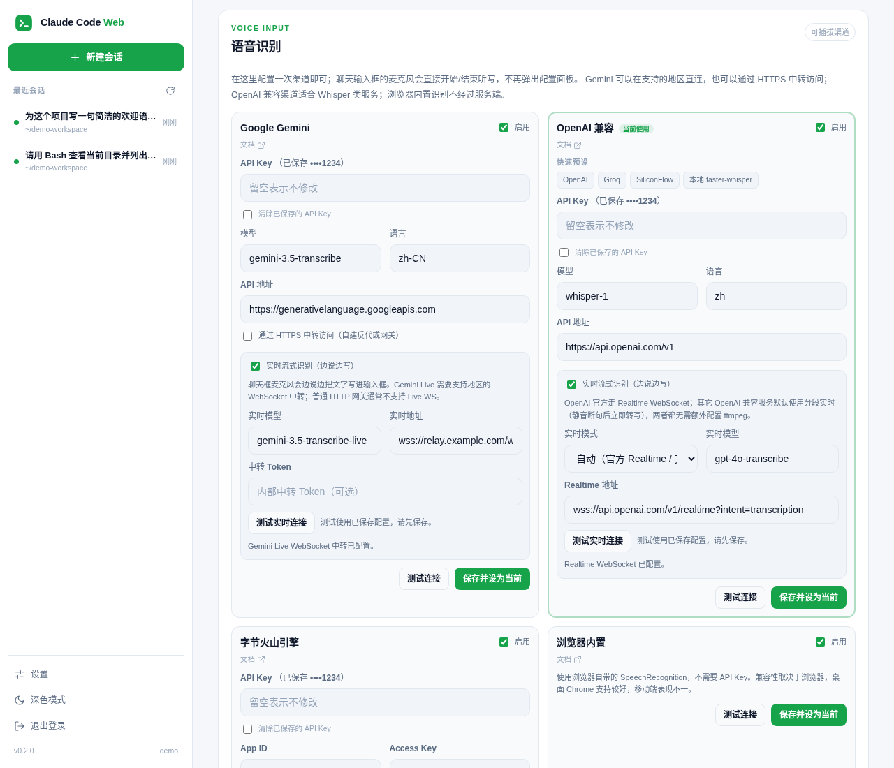
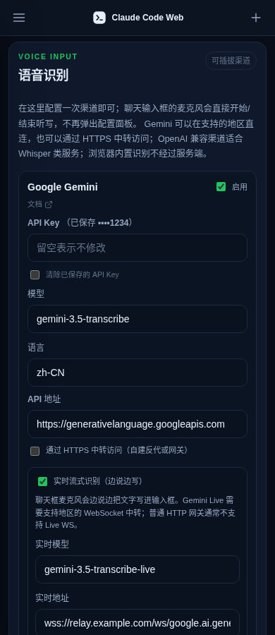
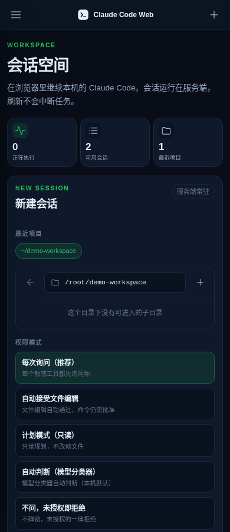

# Claude Code Web

English | [简体中文](README.md)

[](https://github.com/yizhi-shi/claude-web/releases)
[](LICENSE)
[](https://nodejs.org/)
[](https://docs.anthropic.com/en/docs/claude-code)

A self-hosted web console for **Claude Code**. Sessions run on the server, so refreshing the page, closing the tab or switching to your phone never interrupts what Claude is working on.

Built for personal Linux machines and trusted local networks. It listens on `0.0.0.0:8010` by default and asks you to create the administrator account on first visit.

> Claude Code Web is at 0.x and moving quickly. Back up the `data/` directory before upgrading.

## Why this exists

Claude Code usually lives in a terminal or an IDE. Step away from the desk, check progress from your phone, or move to another machine mid-task, and the interaction breaks.

Claude Code Web moves the interaction layer into the browser while keeping the session process on the server:

- The page is just a view of a session; dropping the WebSocket does not stop Claude.
- Reopening the page restores the running state, history, pending approvals and background tasks.
- One responsive layout for desktop and phone, with light, dark and system themes.

It is not a browser terminal or a full IDE. The goal is to make Claude Code sessions easier to watch, approve and resume.

## Features

**Sessions**

- Sessions stay alive on the server. Refresh the page, close the tab or switch devices, and the running state, history, pending approvals and background tasks come back.
- Multiple workspaces, plus scanning and resuming existing Claude Code / VS Code sessions on the same machine.
- History is paginated by renderable events; scrolling to the top loads earlier messages.

**Chat and tools**

- Streaming text and thinking, Markdown, syntax highlighting, tool cards, command output and file diffs.
- The status strip shows the active tool, elapsed time, background tasks, context usage, cost and compaction state.
- Permission approvals for once, this session or deny, with automatic denial on timeout.
- Native panels for `AskUserQuestion` and plan approval (`ExitPlanMode`); pending questions survive a refresh.
- Messages sent during a running turn appear immediately and are confirmed once the CLI echoes their UUID.
- Images returned by tools render as thumbnails with an in-page lightbox; full tool output opens as plain text in a new tab.

**Input**

- `/` command and skill menu, `@` file references.
- Paste, drag or pick files. Images go to the model as image blocks, small text files are inlined, and other files are passed by absolute path.
- Voice input through Gemini, OpenAI-compatible services, Volcengine or the browser, with whole-utterance transcription and real-time streaming.
- `/btw` side questions: ask something mid-task without interrupting the main conversation or writing to its history.

**Interface and deployment**

- Responsive desktop and mobile layout with light, dark and system themes.
- Chinese and English UI, following the browser language on first visit and switchable at any time.
- MCP status, reconnect and session-scoped enable/disable, plus a read-only subagent list.
- User-level or system-level installation with a systemd service; release bundles ship production dependencies.
- Release installs can check, install and roll back updates from Settings. Releases are Ed25519-signed and switched atomically.

## Screenshots

<p align="center">
  
  
</p>
<p align="center">
  
  
</p>
<p align="center">
  
  
</p>
<p align="center">
  
  
</p>

> Screenshots use demo data and contain no real account information. Configure a voice provider once in Settings; the mic button in the composer then starts dictation directly.

## Quick start

### Requirements

- Linux (systemd recommended)
- Node.js 20+
- git and curl
- An installed and logged-in `claude` CLI (`claude --version` works)

### Install from a release (recommended)

The release bundle includes production dependencies, so the target machine does not need npm or a build toolchain.

```bash
git clone https://github.com/yizhi-shi/claude-web.git ~/claude-web-src
cd ~/claude-web-src
./install.sh --release
```

Then open:

```text
http://<device-LAN-IP>:8010
```

The first visit shows the "initialize administrator" page, where you choose your own username and password (there is no default password). Data lives in `~/.local/share/claude-web/data` and is created on first start. See [Release packaging and system updates](docs/UPDATER.md) for the version layout, `current` symlink and update mechanism.

Common options:

```bash
./install.sh --port 8010 --host 0.0.0.0
./install.sh --permission-mode bypassPermissions   # personal trusted machine: allow everything by default
sudo ./install.sh --system --dir /opt/claude-web --user "$SUDO_USER"
```

### Install from source

For development and debugging. This runs `npm ci` and `npm run build` on the target machine and does not enable automatic updates.

```bash
git clone https://github.com/yizhi-shi/claude-web.git ~/claude-web-src
cd ~/claude-web-src
./install.sh --from-dir .
```

### First login and account

1. Open `http://<device-IP>:8010`; the first visit shows "Initialize administrator".
2. Usernames allow letters, digits and `.` `_` `@` `-`, 1–64 characters; passwords need at least 8 characters.
3. A successful setup logs you in automatically. The password is stored only as a bcrypt hash in local `data/auth.json` (0600).
4. Five consecutive wrong passwords lock the account for one hour; the login endpoint also has per-IP rate limiting.
5. You can configure SMTP under Settings → Administrator account → Email sign-in verification and enable an email code as a second factor. The SMTP password is stored only in server-side `data/mail.json` (0600) and is never returned by the API. If SMTP breaks, run `npm run disable-2fa` in the install directory on the server to turn the second factor off locally.
6. If you forget the password, run this in the install directory on the server:

   ```bash
   npm run set-password -- <username> <new-password>
   systemctl --user restart claude-web   # use systemctl restart claude-web for a system service
   ```

   You can also change it after login under Settings → Administrator account.

### Service management

```bash
systemctl --user status claude-web
journalctl --user -u claude-web -f
# Source install: build and restart from a terminal or Claude Code window outside the service
./scripts/restart-service.sh --build
# Release install: check / roll back
node ~/.local/share/claude-web/bin/claude-web-update.mjs check
node ~/.local/share/claude-web/bin/claude-web-update.mjs rollback
```

### Upgrade and uninstall

For release installs, use Settings → System update to check, install and roll back. The console asks for confirmation when sessions are running, and the service is briefly stopped during the update.

Source installs can be upgraded manually:

```bash
cd ~/.local/share/claude-web
git pull --ff-only
npm ci
npm run build
systemctl --user restart claude-web
```

Uninstall (data is kept by default):

```bash
./uninstall.sh
./uninstall.sh --purge --yes   # also remove the install directory and data
```

<details>
<summary>Let an agent install it</summary>

Give the following block to Claude Code or another terminal agent:

```text
You are a Linux operations assistant. Install and verify Claude Code Web on this machine:

1. Check that node -v is >= 20, and that npm, git and claude --version work; claude must already be logged in.
2. Run:
   git clone https://github.com/yizhi-shi/claude-web.git ~/claude-web-src
   cd ~/claude-web-src
   ./install.sh --from-dir . --port 8010 --host 0.0.0.0
3. Wait for the service and verify:
   curl -fsS http://127.0.0.1:8010/api/health
   systemctl --user is-active claude-web
4. Report the access URL (http://<LAN-IP>:8010) and explain that the first visit creates the administrator account.
5. Never print keys, tokens or the contents of files under data/.

Acceptance: health returns ok, the service is active, port 8010 is listening, and the home page loads.
```

</details>

## Configuration

| Variable | Default | Description |
|---|---|---|
| `PORT` | `8010` | Listen port |
| `HOST` | `0.0.0.0` | Listen address |
| `DATA_DIR` | `./data` | Account, session index, transcripts, attachments and voice config |
| `MAX_ATTACHMENTS` | `5` | Maximum attachments per message |
| `MAX_ATTACHMENT_MB` | `10` | Maximum size per attachment in MB; base64 adds roughly 1/3 |
| `MAX_TOTAL_ATTACHMENT_MB` | `20` | Total attachment size per message |
| `ALLOWED_ROOTS` | User home | Roots allowed as workspaces, comma-separated |
| `DEFAULT_WORKSPACE` | First allowed root | Default directory for new sessions (must be allowed) |
| `DEFAULT_PERMISSION_MODE` | `default` | Default permission mode for new sessions; personal trusted machines may use `bypassPermissions` |
| `DEFAULT_THEME` | `system` | Default appearance for the login page and new browsers: `system` / `dark` / `light` |
| `SESSION_IDLE_MINUTES` | `30` | Idle minutes before the background CLI sleeps; sending again resumes it |
| `PERMISSION_TIMEOUT_MINUTES` | `30` | Automatically deny approvals after this timeout |
| `LOGIN_MAX_ATTEMPTS` | `8` | Maximum login attempts per rate-limit window |
| `LOGIN_WINDOW_MINUTES` | `10` | Login rate-limit window in minutes |
| `ACCOUNT_LOCK_ATTEMPTS` | `5` | Consecutive failure threshold for account lockout |
| `ACCOUNT_LOCK_MINUTES` | `60` | Lockout duration in minutes |
| `SESSION_DAYS` | `7` | Login cookie lifetime in days |
| `COOKIE_SECURE` | `auto` | `auto` / `always` / `never`; use `always` for public HTTPS |
| `CLAUDE_BIN` | `claude` on `PATH` | Absolute path to the CLI (recommended for systemd) |
| `TRUST_PROXY` | `true` | Read the real client IP behind a reverse proxy |
| `MAIL_ENV_FILE` | `./data/mail.env` | SMTP credential fallback; `data/mail.json` saved from Settings takes precedence. Both files should be 0600 |
| `VOICE_PROXY_URL` | empty | Optional HTTP egress proxy for voice requests; direct when unset |
| `GEMINI_LIVE_URL` | empty | Gemini Live WebSocket relay URL (requires a Google-supported region) |
| `GEMINI_LIVE_PROXY_TOKEN` | empty | Internal auth token for the Live relay (optional, server-side only) |
| `GEMINI_LIVE_MODEL` | `gemini-3.5-transcribe-live` | Live model |
| `LOG_LEVEL` | `info` | Server log level |

Workspaces can be extended under Settings → Workspace directories, where you can add extra directories and choose the default; new sessions can also create folders directly. See [`.env.example`](.env.example) for the full list.

`bypassPermissions` is not passed to the CLI directly: because the CLI refuses `--dangerously-skip-permissions` as root, the console starts in `default` mode and approves requests from `canUseTool`. Tool calls are still recorded.

### Voice input

Choose a provider and enter its key under Settings → Voice, then save and make it current. Configuration is shared by desktop and mobile, and the mic button in the composer starts or stops dictation directly. Keys are written only to server-side `data/voice.json` (0600), and the page shows a mask.

- **Google Gemini**: default model `gemini-3.5-transcribe`. Direct access is rejected in some regions; enable "access through relay" and enter the HTTPS relay root URL and auth header.
- **OpenAI-compatible**: presets for OpenAI, Groq, SiliconFlow and local faster-whisper; works with any service exposing `/v1/audio/transcriptions`.
- **Volcengine**: enter App ID, Access Key and Resource ID. For whole-utterance transcription the server converts browser audio to 16 kHz PCM with `ffmpeg`, then uses the WebSocket recognizer.
- **Browser built-in**: uses `SpeechRecognition`, needs no key, and depends on browser support.

Real-time streaming (write while speaking) is available for all three server-side providers:

- **Gemini Live** needs a WebSocket relay that can reach Google (this project does not ship one). Set the relay URL and internal token in Settings or through environment variables.
- **OpenAI-compatible** in "auto" mode uses the Realtime WebSocket for official OpenAI and segmented live transcription for other services; you can also force either mode.
- **Volcengine** connects directly to its streaming WebSocket and sends 16 kHz PCM without `ffmpeg`.

If real-time recognition fails or is not configured, it falls back to whole-utterance transcription. Browser microphones work only on HTTPS or `localhost`, so use HTTPS for public deployments. See [Voice recognition](docs/VOICE-ASR.md) for provider details and limitations.

### Attachments

The composer supports three ways to attach files: the Attach button, pasting images or files, and dragging files into the chat page. Files upload to `data/attachments/<sessionId>/` on the server, and messages reference attachment ids. The server validates ownership and size, then converts attachments into model-consumable content:

- Images (PNG/JPEG/GIF/WebP) → Anthropic `image` content blocks;
- Small text files (≤64 KB, 128 KB total inline budget per message) → inlined into `text` blocks;
- Other files → an absolute path in the message, which Claude reads on demand with the Read tool.

Transcripts store only `id/name/mimeType/size/kind`, never file bytes. Limits are 5 attachments per message, 10 MB per file and 20 MB total by default, all configurable through environment variables. Images replay through random capability URLs; non-image downloads still require a signed-in session. See [Attachment pipeline](docs/ATTACHMENTS.md) for the full flow and security boundaries.

Images returned by tools (for example `Read` on a PNG) use a separate pipeline: the bytes live under `data/tool-images`, the transcript keeps only a descriptor, and tool cards render thumbnails with an in-page lightbox. See [Tool-result images, text preview and in-turn append](docs/TOOL-IMAGES.md).

### Native Web commands

The CLI's `/model` usually returns synthetic text in a terminal. The Web console turns these system configuration commands into native UI:

| Command | Web behavior |
|---|---|
| `/model` | Opens the model panel: current model, common presets and a custom model ID |
| `/model <name>` | Switches the model directly; `/model default` restores the default |
| `/context` | Opens the status panel and refreshes context usage |
| `/usage` / `/status` | Shows session state, model, permissions, directory, cost and context |
| `/permissions` | Opens the permission-mode picker |
| `/mcp` / `/agents` / `/list-agents` | Opens the extensions panel: MCP status, tools, errors, reconnect and enable/disable; read-only subagent list |
| `/config` | Opens Web session settings |
| `/help` | Opens Web command help |

These commands are not sent to the CLI and do not produce `<synthetic>` conversation turns. Other `/commands` and skills continue to the Claude Code CLI; `<synthetic>` system messages render as system notices.

The MCP panel only reads the current session's status and performs session-scoped enable/disable and reconnect. It does not send MCP env, headers or command paths to the browser, and never edits config files. The plugin marketplace, `/reload-plugins` and hooks management remain CLI-managed; see [Extension management scope](docs/EXTENSIONS.md) for the rationale.

## How it works

- Each Web session has a server-side `ClaudeRuntime` that holds the CLI process through the Agent SDK's streaming `query()`. The browser only subscribes to events and never owns the process.
- Events are appended to `data/transcripts/<sessionId>.jsonl`. On attach, the WebSocket sends a snapshot and replays everything after `lastSeq`, so a refresh does not lose state.
- Permission approvals suspend inside the SDK's `canUseTool` callback. The UI shows the command or file diff and returns the user's choice.
- The frontend is a Vue 3 single-page app that consumes normalized events; Markdown, tool cards, diffs and panels are rendered there.

For the full design and trade-offs, see [Architecture and invariants](docs/ARCHITECTURE.md) and [Core implementation](docs/IMPLEMENTATION.md).

## Security

This console is equivalent to a **remote terminal for the service user**. Anyone who can sign in can execute commands and modify files with that user's permissions.

- Never expose port 8010 directly to the public internet. Use a reverse proxy, HTTPS and an identity gateway, with the in-app login as a second layer.
- The default permission mode (`default`) is the safest. `bypassPermissions` executes tools immediately; use it only on a personal trusted machine.
- Accounts, SMTP settings, voice keys and transcripts all live under the server-side `data/` directory, with sensitive files at 0600. Treat it as sensitive data when backing up, migrating or sharing an environment.
- For production, run as a dedicated user and add only the project directories you need to `ALLOWED_ROOTS`.
- Report security issues through the private channel described in the [security policy](SECURITY.md); do not open a public issue.

## FAQ

**Does closing the browser stop a task?**

No. The session process runs on the server and the WebSocket only attaches to it. Reopening the page restores state from the event log; normally, only a service restart, an explicit stop or an unexpected CLI exit interrupts the current turn.

**Can I use it from my phone or over the internet?**

On a local network, open it directly in a mobile browser. Public access needs your own HTTPS reverse proxy, ideally with an additional identity gateway. Browser microphones work only on HTTPS or `localhost`.

**How does this relate to the VS Code extension?**

Both use the local `claude` CLI and the sessions under `~/.claude/projects`. The Web console can scan and resume sessions created by the extension or terminal, but it is not a replacement for the extension and does not reuse its UI code.

**Where is data stored, and how do I back it up?**

Release installs and `install.sh --from-dir` use `~/.local/share/claude-web/data` by default; running `npm start` manually uses `data/` in the project. The directory holds accounts, sessions, attachments and voice configuration. Back up `data/`; upgrades do not overwrite it.

**Why no built-in terminal, file tree or multi-agent orchestration?**

The project is a structured session console, not a browser IDE. Those capabilities either enlarge the attack surface significantly or make the product much heavier, so they remain roadmap items to evaluate when needed. See the [Roadmap](docs/ROADMAP.md).

## Development

```bash
npm ci
npm run build
DATA_DIR=./data PORT=8010 node dist/server/index.js
```

Development mode:

```bash
npm run dev:server   # Fastify, :8010
npm run dev:web      # Vite, :5173, proxies /api and /ws
```

Other checks:

```bash
node scripts/check-upstream.mjs    # local CLI / SDK / VS Code extension versions
npm run check-secrets              # scan for known secret patterns
curl -fsS http://127.0.0.1:8010/api/health
```

`npm run build` must pass; there is currently no lint script or unit-test framework. Browser smoke tests are not included in this repository. Read [CONTRIBUTING.md](CONTRIBUTING.md) before opening a PR.

Directory layout:

```text
server/src    Fastify, Agent SDK host, session runtime, attachments and voice
web/src       Vue 3 single-page app (login, sessions, chat, settings)
scripts       Password reset, upstream version check, release packaging, standalone updater
deploy        systemd / nginx templates, update signing public key
docs          Architecture, implementation, deployment, voice, attachments, extensions
```

## Documentation

- [English documentation index](docs/README.en.md) / [中文文档索引](docs/README.md)
- [Architecture and invariants](docs/ARCHITECTURE.md) (Chinese)
- [Core implementation notes](docs/IMPLEMENTATION.md) (Chinese)
- [Deployment guide (manual / agent)](docs/DEPLOYMENT.md) (Chinese)
- [Release packaging and system updates](docs/UPDATER.md) (Chinese)
- [Voice recognition](docs/VOICE-ASR.md) (Chinese)
- [Attachment pipeline](docs/ATTACHMENTS.md) (Chinese)
- [MCP / subagents / plugins: Web management scope](docs/EXTENSIONS.md) (Chinese)
- [VS Code extension feature parity](docs/FEATURE-PARITY.md) (Chinese)

The entry documents are fully bilingual. Design documents use Chinese as the canonical text, with English summaries in the documentation index. See [docs/I18N.md](docs/I18N.md) for the rules.

## Contributing

Issues and pull requests are welcome. For bug reports, include the version, reproduction steps and your environment. For changes to the runtime, permissions or data formats, please open an issue first. Report security issues privately rather than in a public issue.

## Disclaimer

Claude Code Web is an independent open-source project and is not affiliated with Anthropic. Claude and Claude Code are trademarks of Anthropic.

## License

[MIT](LICENSE)
