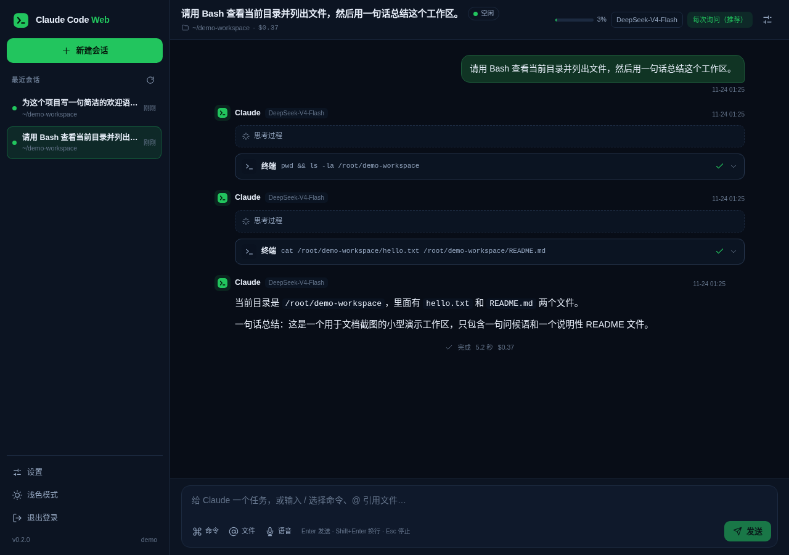
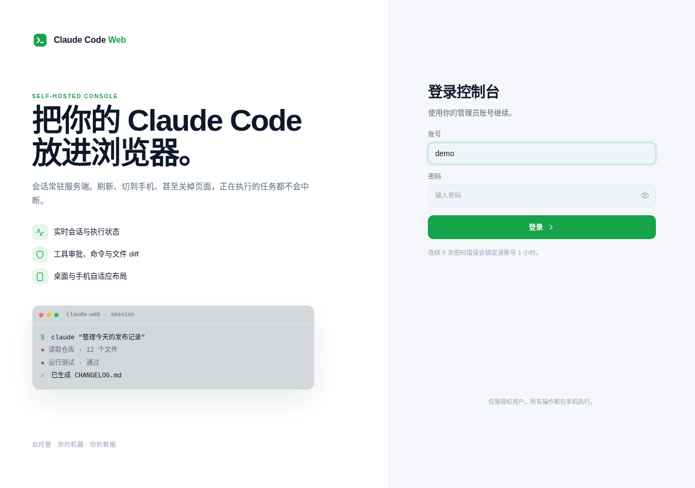

# Claude Code Web

[](LICENSE)
[](https://nodejs.org/)
[](https://docs.anthropic.com/en/docs/claude-code)

[简体中文](README.md) | English

A self-hosted console for managing the local **Claude Code** from a browser. Sessions stay alive on the server, so refreshing the page, closing it, or switching to a phone never interrupts a running task.

> Designed for a personal Linux machine or a trusted LAN. It listens on `0.0.0.0:8010` by default and asks you to create the administrator account on first launch.

---

## Why it exists

Claude Code normally lives in a terminal or an IDE. When you leave the desk, want a quick look from your phone, or need to switch devices mid-task, the interaction breaks.

Claude Code Web moves the interaction layer into the browser while keeping the **session process on the server**:

- The page only *attaches* to a session; dropping the WebSocket does not stop Claude.
- Reopening the page restores the running state, history, pending approvals and background tasks.
- Multiple projects, session history, tool approvals, file diffs, slash commands/skills, `@` file references, image/file attachments, side questions (`/btw`) and voice input are supported.
- History is paginated by renderable events, and scrolling to the top loads earlier messages. Messages sent during a running turn appear immediately with queued/delivered status.
- One responsive layout for desktop and mobile, with light/dark themes.

---

## Features and implementation

| Feature | Problem it solves | Core implementation |
|---|---|---|
| First-run setup + login | Establish an access boundary before LAN/public use | Set the administrator on first launch; passwords are bcrypt-hashed in `data/auth.json`; HttpOnly + SameSite signed cookie; five consecutive failures lock the account for one hour, plus per-IP rate limiting |
| Persistent sessions | Refreshing/closing the page must not kill the task | Each session has a server-side `ClaudeRuntime` that keeps the CLI process alive through the Agent SDK's streaming input; the browser WebSocket only subscribes to events and never owns the process |
| Automatic recovery | Reopening the page should show a task that is still running | Events are persisted to `data/transcripts/<id>.jsonl`; reconnect replays from `lastSeq` and sends the current run state, active tools, pending approvals and background tasks |
| Streaming conversation | Typewriter output and visible tool execution | SDK `includePartialMessages` yields text/thinking deltas, normalized into `assistant.delta` / `assistant.message` and pushed over WebSocket; the frontend renders Markdown and tool cards |
| Permission approvals | Dangerous commands need human confirmation | The SDK `canUseTool` callback suspends the request and sends it to the browser; the UI shows the command or a file diff; the answer is allow once / allow session / deny, with automatic denial on timeout |
| Interactive questions / plan approval | Claude must not stall when it needs a choice or plan approval | `AskUserQuestion` renders a single/multi-select card and returns answers through `updatedInput.answers`; `ExitPlanMode` shows the plan from the preceding assistant message and supports approve, keep planning and feedback. Pending items live in runtime state and survive refresh; questions appear even when the session default is allow-all |
| Default allow-all mode | Personal trusted environments should not require a click for every tool | The UI selects `bypassPermissions`; because the CLI refuses `--dangerously-skip-permissions` as root, the server uses `default` mode plus a `canUseTool` auto-allow equivalent (tool calls are still recorded) |
| Session history / resume | Reuse sessions that already exist in the terminal or VS Code | Scan `~/.claude/projects/*/*.jsonl`; normalize Claude transcripts into Web events; resume the same session; load only a recent window for large histories with a "load earlier" action |
| History pagination / queued messages | History must survive refresh; queued sends must be visible | History queries use `compact=1`, skipping token-level `assistant.delta` and paginating by message events; scrolling to the top auto-loads earlier messages. Messages sent during a turn enter the transcript immediately with `queued`; at the turn boundary the server emits `user.message.delivered`, or `user.message.failed` on stop; the composer shows the queue chip |
| Live execution state | Know what is running and for how long | Maintain an active-tool list from `tool_use` / `tool_result` / `tool_progress` / task events; show the current tool, elapsed time, background tasks, context usage, cost and compaction status |
| Workspace configuration | Choose where a session runs | `ALLOWED_ROOTS` plus extra/default directories in `data/workspaces.json`; every cwd is realpath- and allowlist-validated; the picker can create folders |
| Commands / skills / file references | Match the VS Code extension's input capabilities | Read `slash_commands` and `skills` from `system/init`; typing `/` opens the command/skill menu; typing `@` searches project files with `rg --files` and inserts a relative path. `/model`, `/context`, `/usage`, `/status`, `/permissions`, `/config`, `/help`, `/mcp`, `/agents` are handled by native Web panels; other commands go to the CLI |
| System-command adaptation | CLI configuration output should not masquerade as Claude replies | `/model` and similar commands are handled by native panels; assistant messages with `model: "<synthetic>"` render as system notices without the `<synthetic>` model chip; empty `No response requested.` messages do not occupy the conversation |
| MCP / subagent status | Know whether extensions are actually available | The `/mcp` panel shows MCP status, tools and errors for the current session, with reconnect and session-scoped enable/disable; `/agents` lists subagents read-only. Plugin marketplace, hooks and MCP auth remain CLI-managed; MCP env/headers/command paths are never sent to the browser |
| Image / file attachments | Screenshots, logs and documents should not be retyped | Paste images, drag files or use the file picker; the server stores them under `data/attachments` (0600) and references them by id. On send, images become Anthropic `image` blocks, small text files are inlined, and other files are passed to Claude by absolute path; history renders thumbnails/file chips |
| Side question (`/btw`) | Ask a quick question during a running task without interrupting it | The header opens a floating panel (bottom-right on desktop, bottom card on mobile); drag the top handle to resize, double-click to reset. The server builds a compact context from recent renderable events and runs an ephemeral, tool-less, non-persisted, non-resumed query. Answers never enter the main conversation; cancel is supported and cost is shown separately |
| Voice input | Fast input on a phone or hands-free | The mic starts/stops dictation directly; the default is whole-utterance WebM upload, with optional real-time streaming. Configure the provider once in Settings → Voice. Supports Gemini 3.5 Transcribe / Live, OpenAI-compatible (official Realtime or segmented live; OpenAI/Groq/SiliconFlow/local faster-whisper), Volcengine streaming WebSocket and the browser SpeechRecognition |
| Responsive layout / themes | Work well on desktop and phone | Vue 3 + CSS variables + `100dvh` + mobile drawer sidebar/bottom composer; light and dark token sets; server-wide default appearance (system/light/dark) applies to the login page and new browsers |
| Chinese/English UI | Both Chinese and English users can use the console directly | `web/src/i18n.ts` ships a Chinese/English dictionary; first visit follows the browser language and the choice is stored per browser; switch from the login card, sidebar footer or Settings → Appearance; dates/status/errors go through `t()` |
| Clean installation | Get a Linux machine online quickly | `install.sh` installs to `~/.local/share/claude-web` by default, builds, registers a `systemd --user` service and enables lingering; `--system` installs under `/opt` |
| Follow the VS Code extension | Avoid missing features after an extension upgrade | `docs/FEATURE-PARITY.md` tracks the capability matrix; `scripts/check-upstream.mjs` prints local CLI/SDK/extension versions for review |

See [docs/ARCHITECTURE.md](docs/ARCHITECTURE.md) for architecture and [docs/IMPLEMENTATION.md](docs/IMPLEMENTATION.md) for implementation details. For English summaries of the Chinese design documents, see [docs/README.en.md](docs/README.en.md).

---

## Screenshots

<p align="center">
  
  
</p>
<p align="center">
  
  
</p>
<p align="center">
  
  
</p>
<p align="center">
  
  
</p>

> Screenshots use sanitized demo data. Voice providers are configured once in Settings; the mic in the chat composer then starts dictation directly.

## Quick start

### Recommended: clean user-level install

Prerequisites: Linux, Node.js 20+, npm, git, and an installed and logged-in `claude` CLI.

```bash
git clone https://github.com/yizhi-shi/claude-web.git ~/claude-web-src
cd ~/claude-web-src
./install.sh --from-dir .
```

For detailed manual and agent-assisted deployment, see [docs/DEPLOYMENT.md](docs/DEPLOYMENT.md).

After installation, open:

```text
http://<device-LAN-IP>:8010
```

The first visit shows the "initialize administrator" page, where you choose your own username and password (there is no default password). Data lives in `~/.local/share/claude-web/data` and is ignored by Git.

Common options:

```bash
./install.sh --port 8010 --host 0.0.0.0
./install.sh --permission-mode bypassPermissions   # personal trusted machine: allow everything by default
sudo ./install.sh --system --dir /opt/claude-web --user "$SUDO_USER"
```

Service management:

```bash
systemctl --user status claude-web
journalctl --user -u claude-web -f
# Build and restart from a terminal/Claude Code window outside the service.
# The script refuses to restart from a session hosted by the service itself.
./scripts/restart-service.sh --build
```

Uninstall (keep data):

```bash
./uninstall.sh
```

### Let an agent install it

Give the following block to Claude Code or another terminal agent:

```text
You are a Linux operations assistant. Install and verify Claude Code Web on this machine:

1. Check that node -v is >= 20, and that npm, git and claude --version work; claude must already be logged in.
2. Run:
   git clone https://github.com/yizhi-shi/claude-web.git ~/claude-web-src
   cd ~/claude-web-src
   ./install.sh --from-dir . --port 8010 --host 0.0.0.0
3. Wait for the service and verify:
   curl -fsS http://127.0.0.1:8010/api/health
   systemctl --user is-active claude-web
4. Report the access URL (http://<LAN-IP>:8010) and explain that the first visit creates the administrator account.
5. Never print keys, tokens or the contents of files under data/.

Acceptance: health returns ok, the service is active, port 8010 is listening, and the home page loads.
```

## First login and account

1. Open `http://<device-IP>:8010`; the first visit shows "Initialize administrator".
2. Choose a username (letters, digits, `.` `_` `@` `-`, 1–64 characters) and a password (at least 8 characters), then confirm.
3. Successful creation logs you in automatically. The password is stored only as a bcrypt hash in local `data/auth.json` (0600) and is never committed to Git.
4. Five consecutive wrong passwords lock the account for one hour; the login endpoint also has per-IP rate limiting.
5. Forgot your password? On the server, run:
   ```bash
   npm run set-password -- <username> <new-password>
   systemctl --user restart claude-web   # use systemctl restart claude-web for a system service
   ```
   Or change it after login under Settings → Administrator account.
6. If you see the login page immediately, the instance is already initialized; reset the password with the previous step if you do not know it.

The default appearance (login page and new browsers) can be set to system/light/dark under Settings → Appearance; the current browser can still switch independently from the sidebar footer.

### Manual run (development)

```bash
npm install
npm run build
DATA_DIR=./data PORT=8010 node dist/server/index.js
```

Development mode:

```bash
npm run dev:server   # Fastify, :8010
npm run dev:web      # Vite, :5173, proxies /api and /ws
```

---

## Configuration

| Variable | Default | Description |
|---|---|---|
| `PORT` | `8010` | Listen port |
| `HOST` | `0.0.0.0` | Listen address |
| `DATA_DIR` | `./data` | Account, session index, transcripts, attachments, voice config |
| `MAX_ATTACHMENTS` | `5` | Maximum attachments per message |
| `MAX_ATTACHMENT_MB` | `10` | Maximum size per attachment in MB; base64 adds roughly 1/3 |
| `MAX_TOTAL_ATTACHMENT_MB` | `20` | Total attachment size per message |
| `ALLOWED_ROOTS` | User home | Roots allowed as workspaces, comma-separated |
| `DEFAULT_WORKSPACE` | First allowed root | Default directory for new sessions (must be allowed) |
| `DEFAULT_PERMISSION_MODE` | `default` | Default permission mode for new sessions; personal trusted machines may use `bypassPermissions` |
| `DEFAULT_THEME` | `system` | Default appearance for the login page and new browsers: `system` / `dark` / `light`; also editable in Settings |
| `SESSION_IDLE_MINUTES` | `30` | Idle minutes before the background CLI sleeps; sending again resumes it |
| `PERMISSION_TIMEOUT_MINUTES` | `30` | Automatically deny approvals after this timeout |
| `ACCOUNT_LOCK_ATTEMPTS` | `5` | Consecutive failure threshold for account lockout |
| `ACCOUNT_LOCK_MINUTES` | `60` | Lockout duration in minutes |
| `CLAUDE_BIN` | `claude` on `PATH` | Absolute path to the CLI (recommended for systemd) |
| `TRUST_PROXY` | `true` | Read the real client IP behind a reverse proxy |
| `VOICE_PROXY_URL` | empty | Optional HTTP egress proxy for voice requests (local proxy or corporate gateway); direct when unset |
| `GEMINI_LIVE_URL` | empty | Gemini Live WebSocket relay URL (requires a Google-supported region) |
| `GEMINI_LIVE_PROXY_TOKEN` | empty | Internal auth token for the Live relay (optional, server-side only) |
| `GEMINI_LIVE_MODEL` | `gemini-3.5-transcribe-live` | Live model |

Workspaces can be extended under Settings → Workspace directories, where you can add extra directories and choose the default; new sessions can also create folders directly.

### Voice recognition

Choose a provider and enter its key under Settings → Voice, then save and make it current. Configuration is shared by desktop and mobile; afterwards the mic button in the chat composer starts/stops dictation directly without opening a provider picker or settings panel. Keys are written only to `data/voice.json` (0600) and the page shows a mask.

- **Google Gemini**: default model `gemini-3.5-transcribe`. Direct access is rejected by Google in some regions; enable "access through relay" and enter the HTTPS relay root URL and its auth header.
- **OpenAI-compatible**: presets for OpenAI, Groq, SiliconFlow and local faster-whisper; works with any service exposing `/v1/audio/transcriptions`.
- **Volcengine**: enter App ID / Access Key / Resource ID; for whole-utterance transcription the server uses `ffmpeg` to convert browser audio to 16 kHz PCM, then uses the WebSocket recognizer.
- **Browser built-in**: uses `SpeechRecognition`, needs no key, and depends on browser support.

Real-time streaming (write while speaking) is available for all three server-side providers:

- **Gemini Live**: uses `gemini-3.5-transcribe-live` and needs a WebSocket relay in a Google-supported region (this project does not ship a relay; deploy a reverse proxy/Worker or use a host in a supported region). The relay URL and internal token can be set in Settings or via `GEMINI_LIVE_URL` / `GEMINI_LIVE_PROXY_TOKEN`.
- **OpenAI-compatible**: in "auto" mode, official OpenAI uses the Realtime WebSocket and other compatible services use segmented live (call `/v1/audio/transcriptions` after a silence break and show one sentence at a time); you can also force Realtime or segmented. Custom Realtime gateways can use `wss://…/v1/realtime?intent=transcription` in Settings.
- **Volcengine**: reuses App ID / Access Key / Resource ID and connects directly to the streaming WebSocket (`/api/v3/sauc/bigmodel`), with 16 kHz PCM and no ffmpeg.

`VOICE_PROXY_URL` lets the server reach these voice services through a local proxy. If real-time recognition fails or is not configured, it falls back to whole-utterance transcription; after stopping dictation only the final transcript is applied, and late partials never rewrite the composer. The composer now places commands/files/voice and stop/send on one row; the running "Stop" is reachable from both the status strip and the composer, shows "Stopping…" immediately, and offers a force-stop escape hatch after 2.5 seconds.

With no provider configured, clicking the mic only points you to Settings and does not request microphone permission. Whole-utterance mode starts/stops on click, uploads the recording, transcribes it and inserts the text at the caret; end-to-end latency depends on recording length and provider, typically 2–5 seconds for short phrases. Browser microphones work only on HTTPS or `localhost`; use HTTPS for public deployments.

### Attachments

The composer supports three ways to attach files: the Attach button, pasting images/files, or dragging files into the chat page. Files are uploaded to `data/attachments/<sessionId>/` on the server, and messages reference only attachment ids; the server validates ownership and size, then converts attachments into model-consumable content:

- Images (PNG/JPEG/GIF/WebP) → Anthropic `image` content blocks, visible to the model;
- Small text files (≤64 KB, 128 KB total inline budget per message) → inlined into `text` blocks so the model can read them even if Read is denied;
- Other files → the message includes an absolute path and Claude reads them on demand with the Read tool.

Transcripts store only attachment `id/name/mimeType/size/kind`, never file bytes; after refresh, images replay through an authenticated attachment endpoint and non-images are forced to download. Limits are 5 attachments per message, 10 MB per file and 20 MB total by default, all configurable through environment variables. See [Attachment pipeline](docs/ATTACHMENTS.md) for the full flow, storage format, security boundaries and limits.

### Native Web commands

The CLI's `/model` usually returns synthetic text such as `Current model: … Available: …` in a terminal; the Web console turns these system configuration commands into native UI:

| Command | Web behavior |
|---|---|
| `/model` | Opens the model panel: current model, Sonnet/Opus/Haiku/Fable/Best/1M/Opus Plan presets and a custom model ID |
| `/model <name>` | Switches the model directly; `/model default` restores the default |
| `/context` | Opens the status panel and refreshes context usage (total, percentage, categories) |
| `/usage` / `/status` | Shows session state, model, permissions, directory, cost and context |
| `/permissions` | Opens the permission-mode picker |
| `/mcp` / `/agents` / `/list-agents` | Opens the extensions panel: MCP status/tools/errors, reconnect/enable/disable; read-only subagent list |
| `/config` | Opens Web session settings (model/permissions/extensions/status) |
| `/help` | Opens Web command help |

These commands are not sent to the CLI and do not produce `<synthetic>` conversation turns. Typing a complete command name and pressing Enter executes it; typing only a prefix still completes from the menu. Other `/commands` and skills continue to the Claude Code CLI; `<synthetic>` system messages returned by the CLI render as system notices instead of pretending to be Claude replies.

The MCP panel only reads the current session's status and performs session-scoped enable/disable/reconnect; it does not send MCP env, headers or command paths, and never edits config files. Authentication or adding servers still happens through `/mcp` in a terminal. The plugin marketplace, `/reload-plugins` and hooks management are deliberately kept out of the Web UI; see [Extension management scope](docs/EXTENSIONS.md) for the rationale.

---

## Security

This console is equivalent to a **remote terminal for the service user**:

- Never expose port 8010 directly to the public internet without authentication. Prefer a VPS reverse proxy + HTTPS + an identity gateway, with the in-app login as a second layer.
- The default `default` permission mode is safest; `bypassPermissions` executes tools immediately and should only be used on a personal trusted machine.
- Accounts, voice keys and transcripts all live under `data/`, which is in `.gitignore`; never commit them.
- If you forget the password, run `npm run set-password -- <username> <new-password>` on the server.
- For production, run as a dedicated user and add only the project directories you need to the workspace.

---

## Directory layout

```text
server/src        Fastify + Agent SDK + session runtime
web/src           Vue 3 SPA (login/sessions/chat/settings)
scripts           Password reset, upstream version check
deploy            systemd / nginx templates
docs              Architecture, feature parity, voice, research, release strategy
install.sh        Clean user-level/system-level install
uninstall.sh      Uninstall
```

## Testing

```bash
npm run build:server
npm run build:web
node scripts/check-upstream.mjs
# After the service starts
curl -fsS http://127.0.0.1:8010/api/health
```

Before publishing, at minimum run the builds above, the health check and one real session regression.

## Documentation

- [Architecture and invariants](docs/ARCHITECTURE.md) (Chinese)
- [Core implementation notes](docs/IMPLEMENTATION.md) (Chinese)
- [Deployment guide (manual / agent)](docs/DEPLOYMENT.md) (Chinese)
- [Roadmap](docs/ROADMAP.md) (Chinese)
- [VS Code extension feature parity](docs/FEATURE-PARITY.md) (Chinese)
- [Voice provider research and configuration](docs/VOICE-ASR.md) (Chinese)
- [Chinese/English UI (i18n)](docs/I18N.md) (Chinese)
- [Attachment pipeline: Web upload to Claude Code](docs/ATTACHMENTS.md) (Chinese)
- [MCP / subagents / plugins: Web management scope](docs/EXTENSIONS.md) (Chinese)
- [Competitive research and trade-offs](docs/COMPETITIVE-RESEARCH.md) (Chinese)
- [UI layout and interaction decisions](docs/UI-DESIGN.md) (Chinese)
- [English documentation index and design summaries](docs/README.en.md)

## License

MIT
