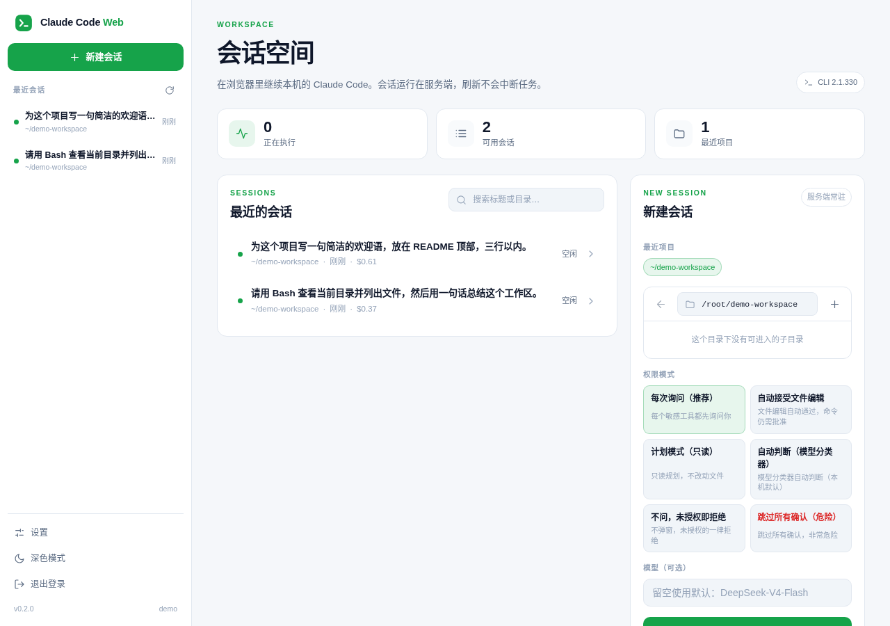
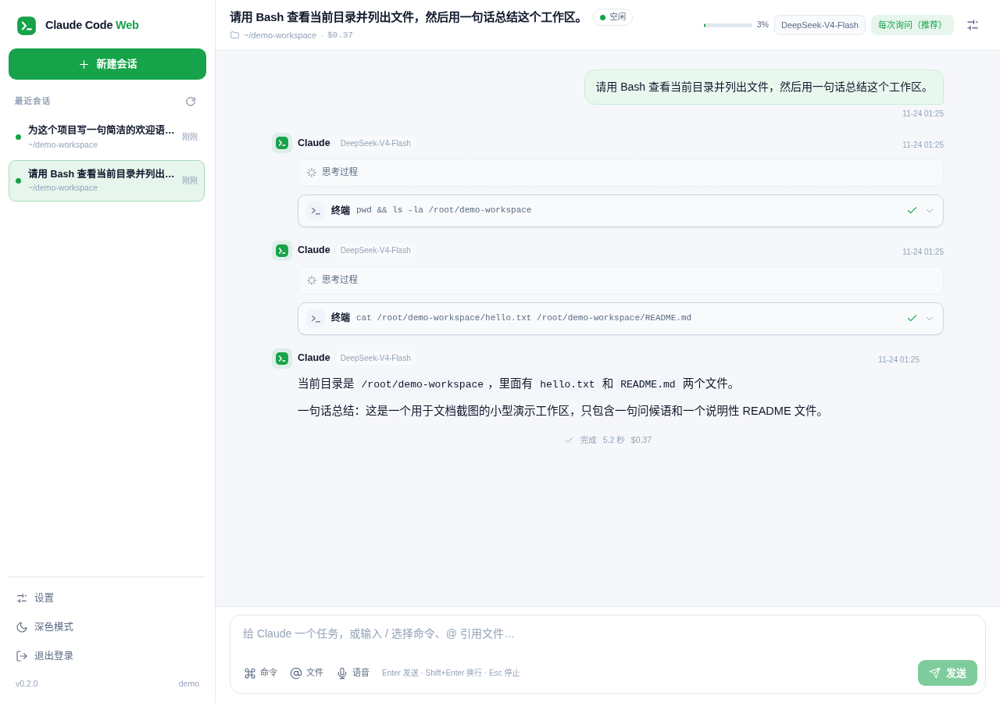

# Claude Code Web

[](LICENSE)
[](https://nodejs.org/)
[](https://docs.anthropic.com/en/docs/claude-code)

在浏览器里管理本机 **Claude Code** 的自托管控制台：会话常驻服务端，刷新、关页面、换手机都不会中断正在执行的任务。

> 面向个人 Linux 设备 / 可信局域网。默认监听 `0.0.0.0:8010`，首次打开设置管理员账号。

---

## 它解决什么问题

Claude Code 的交互在终端或 IDE 里。离开电脑、想用手机看一眼、任务跑到一半要换设备时，体验会断。

Claude Code Web 把交互层搬到浏览器，并把**会话进程留在服务端**：

- 页面只是“附着”到会话；断开 WebSocket 不会停止 Claude。
- 重新打开页面会自动恢复运行状态、历史消息、待审批请求和后台任务。
- 支持多项目、历史会话、工具审批、文件 diff、命令/技能、`@` 文件引用、图片/文件附件、旁问（/btw）和语音输入。
- 历史按“可渲染事件”分页，滚到顶部自动加载更早消息；运行中追加的消息立即出现在对话里，并显示排队/送达状态。
- 桌面与手机共用一套响应式布局，支持亮/暗主题。

---

## 功能与实现原理

| 功能 | 解决的需求 | 实现原理（核心） |
|---|---|---|
| 首次初始化 + 登录 | 公网/局域网使用前先建立访问边界 | 首次打开设置管理员；密码用 bcrypt 存 `data/auth.json`；HttpOnly + SameSite 签名 Cookie；同账号连续 5 次错误锁定 1 小时，另按 IP 限流 |
| 会话常驻 | 刷新/关页面不能中断任务 | 每个会话在服务端有一个 `ClaudeRuntime`，通过 Agent SDK 的流式输入维持 CLI 进程；浏览器 WebSocket 只订阅事件，不拥有进程 |
| 刷新自动恢复 | 页面重开要看到“还在跑”的任务 | 事件持久化到 `data/transcripts/<id>.jsonl`；重连时按 `lastSeq` 回放，并下发当前运行状态、活动工具、待审批、后台任务 |
| 实时对话 | 打字机式输出和工具过程 | SDK `includePartialMessages` 产生文本/思考增量，服务端归一化为 `assistant.delta` / `assistant.message`，经 WebSocket 推送；前端 Markdown + 工具卡片渲染 |
| 权限审批 | 危险命令需要人确认 | SDK `canUseTool` 回调把请求挂起并下发；前端展示命令或新旧文件 diff；返回 allow once / allow session / deny；超时自动拒绝 |
| 交互提问 / 计划确认 | Claude 需要用户选择或批准计划时不能卡住 | `AskUserQuestion` 渲染单选/多选问答卡片，答案经 `updatedInput.answers` 回传；`ExitPlanMode` 展示前一条 assistant 消息中的计划，支持批准、退回完善与修改意见。挂起项存在运行时状态里，刷新可恢复；即使会话默认全部允许，提问仍会显示 |
| “全部允许”默认模式 | 个人可信环境不想每次点确认 | UI 选择 `bypassPermissions`；由于 CLI 禁止 root 使用 `--dangerously-skip-permissions`，服务端用 `default` 模式 + `canUseTool` 自动放行来等价实现（仍记录工具调用） |
| 历史会话 / 续聊 | 复用终端或 VSCode 里已有的会话 | 扫描 `~/.claude/projects/*/*.jsonl`；把 Claude 原始 transcript 归一化为 Web 事件；用 `resume` 恢复同一 session；大历史只加载最近窗口，可“加载更早” |
| 历史分页 / 排队消息 | 刷新后历史不能丢；排队发送要看得见 | 历史查询带 `compact=1`，过滤 token 级 `assistant.delta`，按消息级事件分页；滚到顶部自动加载更早。运行中发送的消息立即入 transcript，`user.message` 带 `queued`；回合边界发 `user.message.delivered`，停止时发 `user.message.failed`，输入区显示排队 chip |
| 实时执行状态 | 知道现在在跑什么、跑了多久 | 从 `tool_use` / `tool_result` / `tool_progress` / task 事件维护活动工具列表；展示当前工具、耗时、后台子任务、上下文占用、费用和压缩状态 |
| 工作区配置 | 会话应该跑在哪个目录 | 环境变量 `ALLOWED_ROOTS` + `data/workspaces.json` 的额外目录/默认目录；所有 cwd 做 realpath + 白名单校验；选择器可直接新建文件夹 |
| 命令 / 技能 / 文件引用 | 对齐 VSCode 插件的输入能力 | 从 `system/init` 读取 `slash_commands` 与 `skills`；输入 `/` 弹出命令/技能菜单；输入 `@` 通过 `rg --files` 搜索当前项目文件并插入相对路径 |
| 图片 / 文件附件 | 截图、日志、文档不想手工转述 | 输入框支持粘贴图片、拖拽文件与文件选择；服务端落盘 `data/attachments`（0600）并以 id 引用。发送时图片转 Anthropic `image` content block，小文本文件内联，其他文件按绝对路径交给 Claude 读取；历史消息渲染缩略图/文件 chip |
| 旁问（/btw） | 任务运行中想快速问一句，又不想打断 | 顶部「旁问」打开浮动面板；服务端用 Agent SDK 的 `resume` + `forkSession` 建一个临时、禁工具、不落盘的查询，基于当前上下文流式回答。答案不进入主对话，可取消，费用单独显示 |
| 语音输入 | 手机/免手操作时快速输入 | 麦克风按钮直接开始/结束听写；默认整段 WebM 上传转写，也可开启实时流式边说边写。渠道在「设置 → 语音识别」配置一次。支持 Gemini 3.5 Transcribe / Live、OpenAI 兼容（官方 Realtime 或分段实时；OpenAI/Groq/SiliconFlow/本地 faster-whisper）、字节火山引擎流式 WebSocket、浏览器内置 |
| 多端布局 / 亮暗主题 | 手机和电脑都要好用 | Vue 3 + CSS 变量 + `100dvh` + 移动端抽屉侧栏/底部输入区；亮暗两套 token；服务端默认外观（跟随系统/亮/暗）作用于登录页与新浏览器 |
| 干净安装 | 一台 Linux 设备快速上线 | `install.sh` 默认用户级安装到 `~/.local/share/claude-web`，构建后注册 `systemd --user` 并 `enable-linger`；也支持 `--system` 安装到 `/opt` |
| 跟随 VSCode 插件 | 插件升级后不漏功能 | `docs/FEATURE-PARITY.md` 维护能力矩阵；`scripts/check-upstream.mjs` 输出本机 CLI / SDK / 插件版本，按清单复核 CLI 与 SDK 类型 |

更细的架构说明见 [docs/ARCHITECTURE.md](docs/ARCHITECTURE.md)；实现机制见 [docs/IMPLEMENTATION.md](docs/IMPLEMENTATION.md)。

---

## 界面预览

<p align="center">
  
  
</p>
<p align="center">
  
  
</p>
<p align="center">
  
  
</p>
<p align="center">
  
  
</p>

> 截图为脱敏演示数据；语音渠道在设置页配置一次，聊天框麦克风直接开始听写。

## 快速开始

### 推荐：用户级干净安装

前置条件：Linux、Node.js 20+、npm、git、已安装并登录的 `claude` CLI。

```bash
git clone https://github.com/yizhi-shi/claude-web.git ~/claude-web-src
cd ~/claude-web-src
./install.sh --from-dir .
```

详细的人工部署与 Agent 部署教程见 [docs/DEPLOYMENT.md](docs/DEPLOYMENT.md)。

安装完成后打开：

```text
http://<设备局域网IP>:8010
```

首次打开会进入“初始化管理员”页面，自行设置账号和密码（没有默认密码）。数据在 `~/.local/share/claude-web/data`，已从 Git 忽略。

常用参数：

```bash
./install.sh --port 8010 --host 0.0.0.0
./install.sh --permission-mode bypassPermissions   # 个人可信设备：默认全部放行
sudo ./install.sh --system --dir /opt/claude-web --user "$SUDO_USER"
```

后台服务：

```bash
systemctl --user status claude-web
journalctl --user -u claude-web -f
# 从服务之外的终端/Claude Code 窗口构建并重启；脚本会拒绝在服务托管的会话里直接重启
./scripts/restart-service.sh --build
```

卸载（保留数据）：

```bash
./uninstall.sh
```

### 让 Agent 帮你安装

把下面这段直接交给 Claude Code / 其他终端 Agent：

```text
你是一名 Linux 运维助手。请在这台机器上安装并验证 Claude Code Web：

1. 检查 node -v 是否 >= 20，npm、git、claude --version 是否可用；claude 必须已登录。
2. 执行：
   git clone https://github.com/yizhi-shi/claude-web.git ~/claude-web-src
   cd ~/claude-web-src
   ./install.sh --from-dir . --port 8010 --host 0.0.0.0
3. 等待服务启动，验证：
   curl -fsS http://127.0.0.1:8010/api/health
   systemctl --user is-active claude-web
4. 输出访问地址（http://<局域网IP>:8010）和“首次打开设置管理员账号”的说明。
5. 不要输出任何密钥、token 或 data/ 下的文件内容。

验收标准：health 返回 ok、服务 active、端口 8010 在监听、首页可访问。
```

## 首次登录与账号

1. 浏览器打开 `http://<设备IP>:8010`，首次会显示「初始化管理员」。
2. 设置用户名（字母、数字、`.` `_` `@` `-`，1–64 位）和密码（至少 8 位），确认后创建。
3. 创建成功会自动登录；密码只以 bcrypt 哈希保存在本机 `data/auth.json`（0600），不会写入 Git。
4. 同一账号连续 5 次密码错误会锁定 1 小时；登录接口另有 IP 频率限制。
5. 忘记密码：在服务器执行
   ```bash
   npm run set-password -- <用户名> <新密码>
   systemctl --user restart claude-web   # 系统服务用 systemctl restart claude-web
   ```
   或登录后在「设置 → 管理员账号」修改。
6. 如果打开直接是登录页，说明已经初始化过；不知道密码时按上一步重置。

默认外观（登录页和新浏览器）可在「设置 → 外观」配置为跟随系统 / 浅色 / 深色；当前浏览器仍可用左下角按钮单独切换。

### 手动运行（开发）

```bash
npm install
npm run build
DATA_DIR=./data PORT=8010 node dist/server/index.js
```

开发模式：

```bash
npm run dev:server   # Fastify, :8010
npm run dev:web      # Vite, :5173，已代理 /api 与 /ws
```

---

## 配置

| 变量 | 默认 | 说明 |
|---|---|---|
| `PORT` | `8010` | 监听端口 |
| `HOST` | `0.0.0.0` | 监听地址 |
| `DATA_DIR` | `./data` | 账号、会话索引、transcript、语音配置 |
| `ALLOWED_ROOTS` | 用户 home | 允许作为工作区的根目录，逗号分隔 |
| `DEFAULT_WORKSPACE` | 第一个允许根目录 | 新建会话的默认目录（必须在允许范围内） |
| `DEFAULT_PERMISSION_MODE` | `default` | 新会话默认权限；个人可信设备可用 `bypassPermissions` |
| `DEFAULT_THEME` | `system` | 登录页与新浏览器的默认外观：`system` / `dark` / `light`；也可在设置页修改 |
| `SESSION_IDLE_MINUTES` | `30` | 空闲多久后休眠后台 CLI；再次发送自动恢复 |
| `PERMISSION_TIMEOUT_MINUTES` | `30` | 审批超时自动拒绝 |
| `ACCOUNT_LOCK_ATTEMPTS` | `5` | 同账号连续失败锁定阈值 |
| `ACCOUNT_LOCK_MINUTES` | `60` | 锁定分钟数 |
| `CLAUDE_BIN` | `PATH` 中的 `claude` | CLI 绝对路径（systemd 环境建议显式设置） |
| `TRUST_PROXY` | `true` | 反向代理下取真实客户端 IP |
| `VOICE_PROXY_URL` | 空 | 可选的语音 HTTP 出口代理（本地代理或公司网关），不配置则直连 |
| `GEMINI_LIVE_URL` | 空 | Gemini Live WebSocket 中转地址（需支持 Google 的地区） |
| `GEMINI_LIVE_PROXY_TOKEN` | 空 | Live 中转的内部鉴权 Token（可选，服务端使用） |
| `GEMINI_LIVE_MODEL` | `gemini-3.5-transcribe-live` | Live 模型 |

工作区可以在「设置 → 工作区目录」里追加额外目录、设置默认目录；新建会话时也能直接新建文件夹。

### 语音识别

在「设置 → 语音识别」选择渠道、填写 Key，保存并设为当前。配置一次即可，桌面和手机共用；聊天输入框的麦克风按钮之后会直接开始/结束听写，不再弹出渠道选择或配置面板。Key 只写入 `data/voice.json`（0600），页面只显示掩码。

- **Google Gemini**：默认模型 `gemini-3.5-transcribe`。部分地区直连会被 Google 拒绝，可开启“通过中转访问”，填入 HTTPS 中转根地址和该服务的鉴权头。
- **OpenAI 兼容**：预设 OpenAI、Groq、SiliconFlow、本地 faster-whisper；适合任何提供 `/v1/audio/transcriptions` 的服务。
- **字节火山引擎**：填 App ID / Access Key / Resource ID；整段转写时服务端用 `ffmpeg` 把浏览器录音转为 16kHz PCM，再走 WebSocket 识别。
- **浏览器内置**：使用浏览器 `SpeechRecognition`，无需 Key，兼容性取决于浏览器。

实时流式（边说边写）在三个服务端渠道都可以开启：

- **Gemini Live**：使用 `gemini-3.5-transcribe-live`，需要支持 Google 地区的 WebSocket 中转（本项目不内置中转服务；可自行部署反向代理/Worker 或使用支持地区的主机）。中转地址和内部 Token 可写在设置页，也可用 `GEMINI_LIVE_URL` / `GEMINI_LIVE_PROXY_TOKEN` 环境变量提供。
- **OpenAI 兼容**：「自动」模式下 OpenAI 官方走 Realtime WebSocket，其它兼容服务走分段实时（静音断句后立即调用 `/v1/audio/transcriptions`，一句话一句话上屏）；也可强制选择 Realtime 或分段。自定义 Realtime 网关可在设置页填写 `wss://…/v1/realtime?intent=transcription`。
- **火山引擎**：复用 App ID / Access Key / Resource ID，直接连接流式 WebSocket（`/api/v3/sauc/bigmodel`），16kHz PCM 不再经过 ffmpeg。

`VOICE_PROXY_URL` 可让服务端经本地代理访问上述语音服务。实时识别失败或未配置时会回退到整段转写；停止听写后只接收最后一版定稿，迟到的 partial 不会继续改写输入框。输入区现在把命令/文件/语音与停止/发送放在同一行，运行中的「停止」在状态条和输入区都可直接点到，停止后立即显示“停止中…”，超过 2.5 秒还会给出强制结束入口。

未配置渠道时，点击麦克风只会提示去设置页，不会请求麦克风权限。整段转写模式按点击开始/结束，整段上传后转写并插入光标；端到端延迟取决于录音长度和渠道，短句通常 2–5 秒。浏览器麦克风只在 HTTPS 或 `localhost` 下可用；公网部署请使用 HTTPS。

---

## 安全

这个控制台等价于**服务运行用户的远程终端**：

- 不要在未加认证的公网直接暴露 8010。建议 VPS 反向代理 + HTTPS + 统一身份网关，应用内登录作为第二层。
- 默认 `default` 权限最安全；`bypassPermissions` 会直接执行工具，请只在个人可信设备使用。
- 所有账号、语音 Key、transcript 都在 `data/`，已加入 `.gitignore`；不要提交。
- 忘记密码可在服务器执行 `npm run set-password -- <用户名> <新密码>`。
- 生产建议用独立用户运行，并只把需要的项目目录加入工作区。

---

## 目录结构

```text
server/src        Fastify + Agent SDK + 会话运行时
web/src           Vue 3 单页应用（登录/会话/聊天/设置）
scripts           密码重置、上游版本检查
deploy            systemd / nginx 模板
docs              架构、功能对照、语音、调研、发布策略
install.sh        用户级/系统级干净安装
uninstall.sh      卸载
```

## 测试

```bash
npm run build:server
npm run build:web
node scripts/check-upstream.mjs
# 服务启动后
curl -fsS http://127.0.0.1:8010/api/health
```

发布前请至少执行上述构建、健康检查和一次真实会话回归。

## 文档

- [架构与不变量](docs/ARCHITECTURE.md)
- [核心实现说明](docs/IMPLEMENTATION.md)
- [部署教程（人工 / Agent）](docs/DEPLOYMENT.md)
- [Roadmap](docs/ROADMAP.md)
- [VSCode 插件能力对照](docs/FEATURE-PARITY.md)
- [语音渠道调研与配置](docs/VOICE-ASR.md)
- [同类项目调研与取舍](docs/COMPETITIVE-RESEARCH.md)
- [UI 布局与交互决策](docs/UI-DESIGN.md)

## 许可证

MIT
