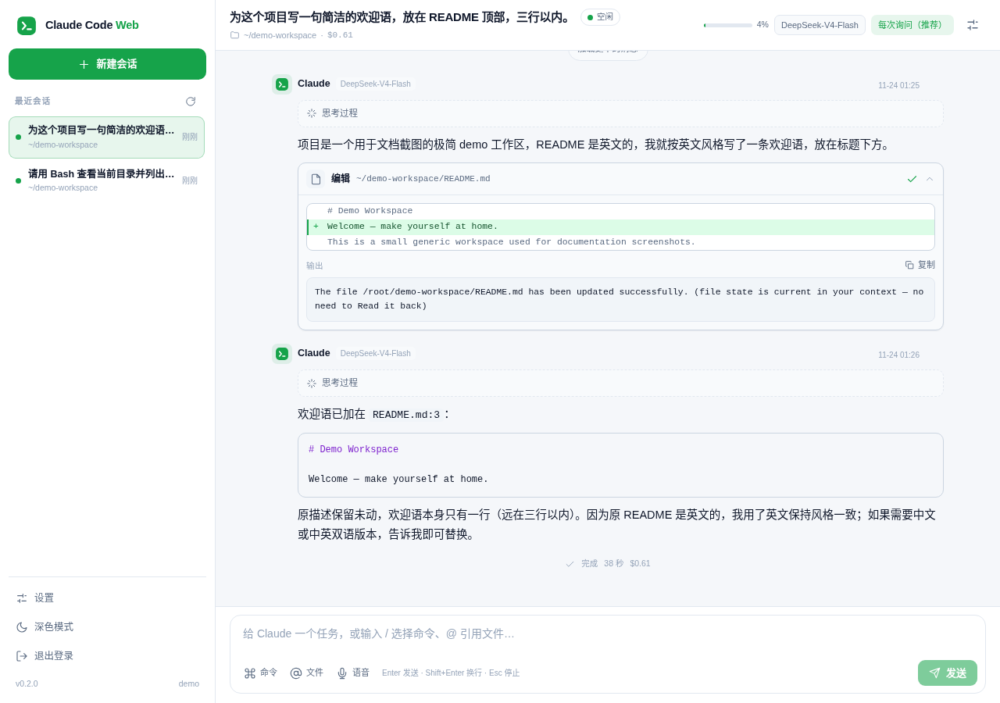
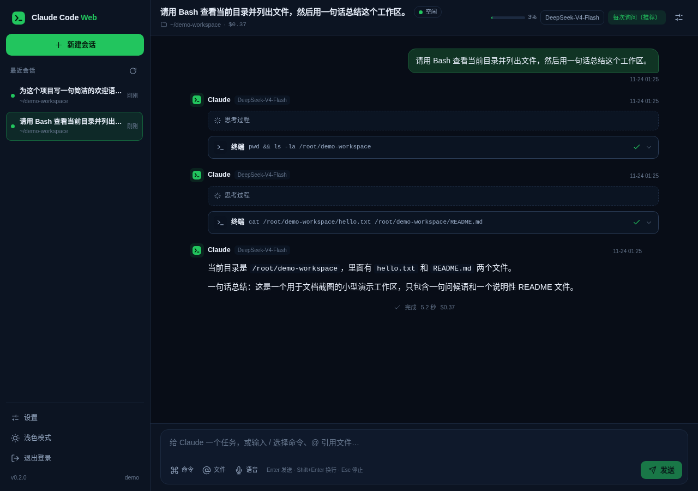
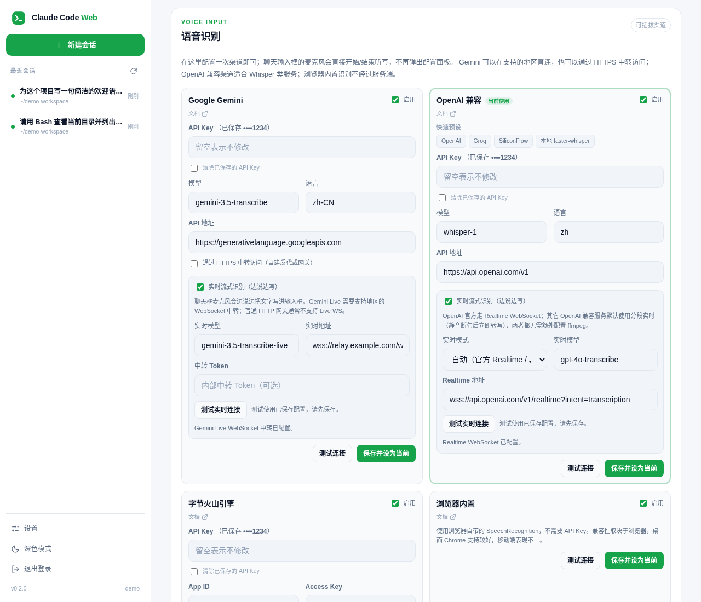
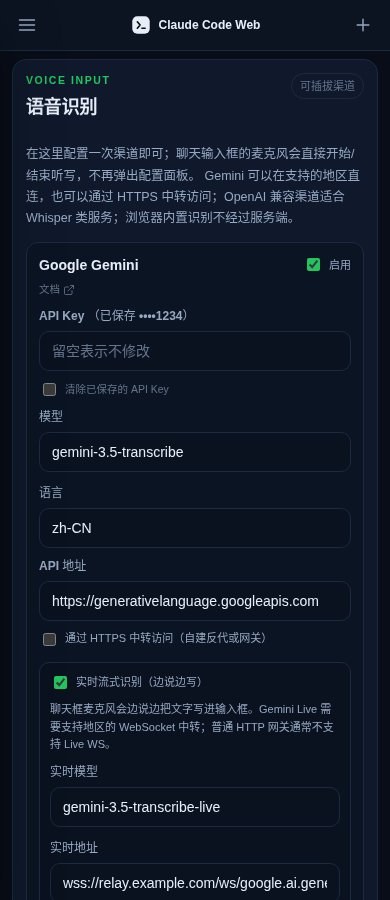
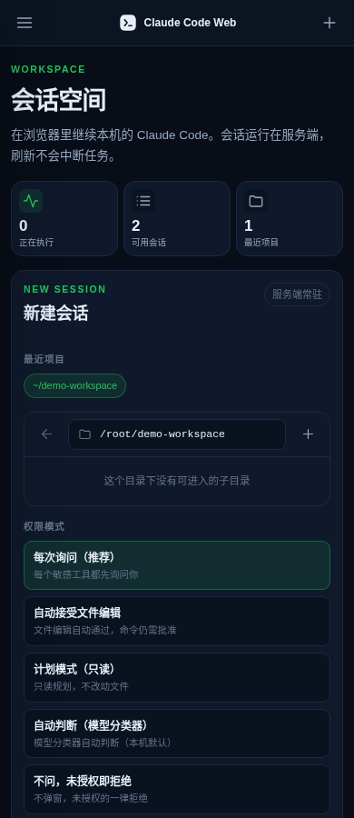
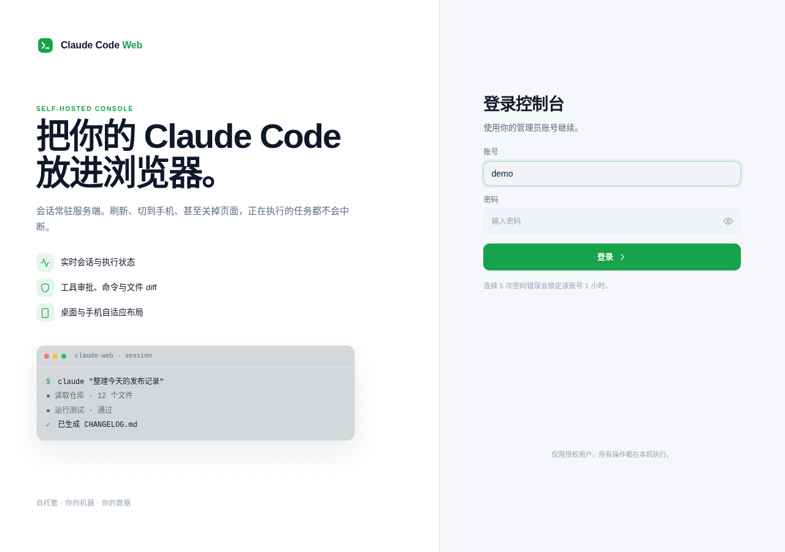

# Claude Code Web

简体中文 | [English](README.en.md)

[](https://github.com/yizhi-shi/claude-web/releases)
[](LICENSE)
[](https://nodejs.org/)
[](https://docs.anthropic.com/en/docs/claude-code)

在浏览器里使用本机的 **Claude Code**。会话运行在服务端，刷新页面、关掉标签页或者换到手机上，正在执行的任务都不会中断。

项目面向个人 Linux 主机和可信局域网，默认监听 `0.0.0.0:8010`，第一次打开时创建管理员账号。

> Claude Code Web 目前是 0.x 版本，功能迭代较快。升级前建议备份 `data/` 目录。

## 为什么做这个

Claude Code 的交互通常发生在终端或 IDE 里。离开电脑、想用手机看一眼进度，或者任务跑到一半要换设备，体验就会断掉。

这个项目把交互层搬到浏览器，同时把会话进程留在服务端：

- 页面只是会话的一个视图，WebSocket 断开不会停止 Claude。
- 重新打开页面会自动恢复运行状态、历史消息、待审批请求和后台任务。
- 桌面和手机共用一套响应式界面，支持亮色、暗色和跟随系统。

它不是网页终端，也不是完整 IDE。目标是把 Claude Code 的会话做得更容易查看、审批和继续。

## 功能

**会话**

- 会话常驻服务端。刷新页面、关闭标签页或换设备后，运行状态、历史消息、待审批请求和后台任务都会恢复。
- 支持多个工作区，可以扫描并续聊本机已有的 Claude Code / VS Code 会话。
- 历史按可渲染事件分页，滚到顶部自动加载更早的消息。

**对话与工具**

- 流式文本和思考过程，Markdown、代码高亮、工具卡片、命令输出和文件 diff。
- 运行状态条展示当前工具、耗时、后台任务、上下文用量、费用和压缩状态。
- 权限审批支持允许一次、允许本会话、拒绝；超时自动拒绝。
- `AskUserQuestion` 和计划确认（`ExitPlanMode`）使用原生面板，刷新后仍可继续回答。
- 运行中发送的消息会立即进入对话，CLI 确认后自动清除「已追加」标记。
- 工具结果里的图片可以在页内预览，工具文本输出可以在新标签页以纯文本打开。

**输入**

- `/` 命令与 Skill 菜单，`@` 文件引用。
- 粘贴、拖拽或选择文件作为附件。图片直接进入模型上下文，小文本内联，其他文件按绝对路径交给 Claude 读取。
- 语音输入支持 Gemini、OpenAI 兼容服务、火山引擎和浏览器内置能力，可整段转写或实时流式。
- `/btw` 旁问：任务运行中快速问一句，不打断主对话，也不写入历史。

**界面与部署**

- 桌面与手机共用一套响应式布局，支持亮色、暗色和跟随系统。
- 中英文界面，首次跟随浏览器语言，可随时切换。
- MCP 状态、重连和当前会话启停，以及只读的子代理列表。
- 用户级或系统级安装，注册 systemd 服务；发布包自带生产依赖。
- 发布包安装可在设置页检查更新、立即更新和回滚。发布包使用 Ed25519 签名，切换版本时原子替换。

## 界面预览

<p align="center">
  
  
</p>
<p align="center">
  
  
</p>
<p align="center">
  
  
</p>
<p align="center">
  
  
</p>

> 截图为演示数据，不含真实账号信息。语音渠道在设置页配置一次，之后聊天框的麦克风按钮会直接开始听写。

## 快速开始

### 环境要求

- Linux（推荐带 systemd）
- Node.js 20+
- git、curl
- 已安装并登录的 `claude` CLI（`claude --version` 可用）

### 安装发布包（推荐）

发布包自带生产依赖，目标机不需要 npm 或构建工具。

```bash
git clone https://github.com/yizhi-shi/claude-web.git ~/claude-web-src
cd ~/claude-web-src
./install.sh --release
```

安装完成后打开：

```text
http://<设备局域网IP>:8010
```

首次访问会进入「初始化管理员」页面，由你设置用户名和密码（没有默认密码）。数据保存在 `~/.local/share/claude-web/data`，首次启动时自动创建。版本目录、`current` 软链和更新机制见 [系统更新](docs/UPDATER.md)。

常用参数：

```bash
./install.sh --port 8010 --host 0.0.0.0
./install.sh --permission-mode bypassPermissions   # 个人可信设备：默认全部放行
sudo ./install.sh --system --dir /opt/claude-web --user "$SUDO_USER"
```

### 从源码安装

适合开发和调试，会在目标机执行 `npm ci` 和 `npm run build`，不启用自动更新。

```bash
git clone https://github.com/yizhi-shi/claude-web.git ~/claude-web-src
cd ~/claude-web-src
./install.sh --from-dir .
```

### 首次登录与账号

1. 浏览器打开 `http://<设备IP>:8010`，首次会显示「初始化管理员」。
2. 用户名支持字母、数字和 `.` `_` `@` `-`，长度 1–64；密码至少 8 位。
3. 创建成功会自动登录。密码只以 bcrypt 哈希保存在本机 `data/auth.json`（0600）。
4. 同一账号连续 5 次密码错误会锁定 1 小时；登录接口另有 IP 频率限制。
5. 可以在「设置 → 管理员账号 → 邮箱登录验证」配置 SMTP，并开启邮箱验证码作为登录第二因素。SMTP 密码只保存在服务端 `data/mail.json`（0600），接口不会回显。SMTP 故障时可在服务器安装目录执行 `npm run disable-2fa` 临时关闭。
6. 忘记密码时，在服务器安装目录执行：

   ```bash
   npm run set-password -- <用户名> <新密码>
   systemctl --user restart claude-web   # 系统服务用 systemctl restart claude-web
   ```

   也可以登录后在「设置 → 管理员账号」里修改。

### 服务管理

```bash
systemctl --user status claude-web
journalctl --user -u claude-web -f
# 源码安装：从服务之外的终端或 Claude Code 窗口构建并重启
./scripts/restart-service.sh --build
# 发布包安装：检查更新 / 回滚
node ~/.local/share/claude-web/bin/claude-web-update.mjs check
node ~/.local/share/claude-web/bin/claude-web-update.mjs rollback
```

### 升级与卸载

发布包安装可以直接在「设置 → 系统更新」里检查更新、安装和回滚。有运行中的会话时会先要求确认，更新过程会短暂停止服务。

源码安装可以手工升级：

```bash
cd ~/.local/share/claude-web
git pull --ff-only
npm ci
npm run build
systemctl --user restart claude-web
```

卸载（默认保留数据）：

```bash
./uninstall.sh
./uninstall.sh --purge --yes   # 同时删除安装目录和数据
```

<details>
<summary>让 Agent 代你安装</summary>

把下面这段交给 Claude Code 或其他终端 Agent：

```text
你是一名 Linux 运维助手。请在这台机器上安装并验证 Claude Code Web：

1. 检查 node -v 是否 >= 20，npm、git、claude --version 是否可用；claude 必须已登录。
2. 执行：
   git clone https://github.com/yizhi-shi/claude-web.git ~/claude-web-src
   cd ~/claude-web-src
   ./install.sh --from-dir . --port 8010 --host 0.0.0.0
3. 等待服务启动，验证：
   curl -fsS http://127.0.0.1:8010/api/health
   systemctl --user is-active claude-web
4. 输出访问地址（http://<局域网IP>:8010），并说明首次打开需要设置管理员账号。
5. 不要输出任何密钥、token 或 data/ 下的文件内容。

验收标准：health 返回 ok、服务 active、端口 8010 在监听、首页可访问。
```

</details>

## 配置

| 变量 | 默认 | 说明 |
|---|---|---|
| `PORT` | `8010` | 监听端口 |
| `HOST` | `0.0.0.0` | 监听地址 |
| `DATA_DIR` | `./data` | 账号、会话索引、transcript、附件、语音配置 |
| `MAX_ATTACHMENTS` | `5` | 单条消息最多附件数 |
| `MAX_ATTACHMENT_MB` | `10` | 单个附件最大 MB；base64 后约膨胀 1/3 |
| `MAX_TOTAL_ATTACHMENT_MB` | `20` | 单条消息附件总大小 |
| `ALLOWED_ROOTS` | 用户 home | 允许作为工作区的根目录，逗号分隔 |
| `DEFAULT_WORKSPACE` | 第一个允许根目录 | 新建会话的默认目录（必须在允许范围内） |
| `DEFAULT_PERMISSION_MODE` | `default` | 新会话默认权限；个人可信设备可用 `bypassPermissions` |
| `DEFAULT_THEME` | `system` | 登录页与新浏览器的默认外观：`system` / `dark` / `light` |
| `SESSION_IDLE_MINUTES` | `30` | 空闲多久后休眠后台 CLI；再次发送自动恢复 |
| `PERMISSION_TIMEOUT_MINUTES` | `30` | 审批超时自动拒绝 |
| `LOGIN_MAX_ATTEMPTS` | `8` | 登录接口在窗口内的最大尝试次数 |
| `LOGIN_WINDOW_MINUTES` | `10` | 登录限流窗口（分钟） |
| `ACCOUNT_LOCK_ATTEMPTS` | `5` | 同账号连续失败锁定阈值 |
| `ACCOUNT_LOCK_MINUTES` | `60` | 锁定分钟数 |
| `SESSION_DAYS` | `7` | 登录 Cookie 有效天数 |
| `COOKIE_SECURE` | `auto` | `auto` / `always` / `never`；公网 HTTPS 建议 `always` |
| `CLAUDE_BIN` | `PATH` 中的 `claude` | CLI 绝对路径（systemd 环境建议显式设置） |
| `TRUST_PROXY` | `true` | 反向代理下取真实客户端 IP |
| `MAIL_ENV_FILE` | `./data/mail.env` | SMTP 凭据回退文件；设置页保存的 `data/mail.json` 优先。两个文件都应为 0600 |
| `VOICE_PROXY_URL` | 空 | 可选的语音 HTTP 出口代理，不配置则直连 |
| `GEMINI_LIVE_URL` | 空 | Gemini Live WebSocket 中转地址（需支持 Google 的地区） |
| `GEMINI_LIVE_PROXY_TOKEN` | 空 | Live 中转的内部鉴权 Token（可选，服务端使用） |
| `GEMINI_LIVE_MODEL` | `gemini-3.5-transcribe-live` | Live 模型 |
| `LOG_LEVEL` | `info` | 服务端日志级别 |

工作区可以在「设置 → 工作区目录」里追加额外目录、设置默认目录；新建会话时也能直接新建文件夹。完整变量说明见 [`.env.example`](.env.example)。

`bypassPermissions` 不是直接透传 CLI 参数：由于 CLI 拒绝 root 使用 `--dangerously-skip-permissions`，控制台以 `default` 启动，并由 `canUseTool` 自动放行。工具调用仍会记录。

### 语音识别

在「设置 → 语音识别」选择渠道、填写 Key，保存并设为当前。配置一次后桌面和手机共用，聊天输入框的麦克风按钮会直接开始或结束听写。Key 只写入服务端 `data/voice.json`（0600），页面只显示掩码。

- **Google Gemini**：默认模型 `gemini-3.5-transcribe`。部分地区直连会被拒绝，可以开启「通过中转访问」，填写 HTTPS 中转根地址和鉴权头。
- **OpenAI 兼容**：预设 OpenAI、Groq、SiliconFlow 和本地 faster-whisper，也适用于任何提供 `/v1/audio/transcriptions` 的服务。
- **字节火山引擎**：填写 App ID、Access Key 和 Resource ID；整段转写时服务端用 `ffmpeg` 转成 16 kHz PCM，再走 WebSocket 识别。
- **浏览器内置**：使用 `SpeechRecognition`，无需 Key，兼容性取决于浏览器。

实时流式（边说边写）对三个服务端渠道都可用：

- **Gemini Live** 需要能访问 Google 的 WebSocket 中转（本项目不内置中转服务），地址和内部 Token 可在设置页或环境变量里配置。
- **OpenAI 兼容** 在「自动」模式下，官方 OpenAI 走 Realtime WebSocket，其他服务走分段实时；也可以手动指定。
- **火山引擎**直接连接流式 WebSocket，16 kHz PCM 不再经过 `ffmpeg`。

实时识别失败或未配置时会回退到整段转写。浏览器麦克风只在 HTTPS 或 `localhost` 下可用，公网部署请使用 HTTPS。各渠道的参数和限制见 [语音渠道](docs/VOICE-ASR.md)。

### 附件

输入框支持三种方式添加附件：点「附件」选择文件、直接粘贴图片或文件、把文件拖进聊天页。文件先上传到服务端 `data/attachments/<sessionId>/`，发送消息时只传附件 id。服务端校验归属与大小后，把附件转成模型可消费的内容：

- 图片（PNG/JPEG/GIF/WebP）→ Anthropic `image` content block；
- 小文本文件（≤64 KB，单条消息总内联预算 128 KB）→ 内联进 `text` block；
- 其他文件 → 在消息里给出绝对路径，Claude 按需用 Read 工具读取。

transcript 只保存附件的 `id/name/mimeType/size/kind`，不保存文件字节。单条最多 5 个、单文件默认 10 MB、总计 20 MB，都可以通过环境变量调整。图片通过随机 capability URL 回放，非图片下载仍要求登录。完整链路和安全边界见 [附件链路](docs/ATTACHMENTS.md)。

Agent 工具返回的图片（例如用 Read 读取 PNG）走独立链路：字节保存在 `data/tool-images`，transcript 只存描述符，工具卡显示缩略图并可在页内 lightbox 预览。详见 [工具结果图片、文本预览与运行中追加](docs/TOOL-IMAGES.md)。

### Web 原生命令

CLI 的 `/model` 在终端里通常只返回一段 synthetic 文本；Web 控制台把这些系统配置命令做成了原生界面：

| 命令 | Web 行为 |
|---|---|
| `/model` | 打开模型面板：当前模型、常用预设和自定义模型 ID |
| `/model <name>` | 直接切换模型；`/model default` 恢复默认 |
| `/context` | 打开状态面板并刷新上下文用量 |
| `/usage` / `/status` | 查看会话状态、模型、权限、目录、费用和上下文 |
| `/permissions` | 打开权限模式选择 |
| `/mcp` / `/agents` / `/list-agents` | 打开扩展面板：MCP 状态、工具、错误、重连与启停；子代理只读 |
| `/config` | 打开 Web 会话设置 |
| `/help` | 打开 Web 命令帮助 |

这些命令不会发送给 CLI，也不会产生 `<synthetic>` 对话。其他 `/命令` 和 Skill 继续交给 Claude Code；CLI 返回的 `<synthetic>` 系统消息会渲染成「系统」通知。

MCP 面板只读取当前会话的状态，并支持会话内启停和重连；它不会把 MCP 的 env、headers 或命令路径发给浏览器，也不修改配置文件。插件市场、`/reload-plugins` 和 hooks 管理仍由 CLI 负责，原因见 [扩展管理范围](docs/EXTENSIONS.md)。

## 工作方式

- 每个 Web 会话在服务端对应一个 `ClaudeRuntime`，通过 Agent SDK 的流式 `query()` 持有 CLI 进程。浏览器只是订阅事件，不拥有进程。
- 事件追加写入 `data/transcripts/<sessionId>.jsonl`。WebSocket 附着时先发快照，再回放 `lastSeq` 之后的事件，所以刷新不会丢状态。
- 权限审批通过 SDK 的 `canUseTool` 回调挂起，前端展示命令或文件 diff，用户选择后再回传结果。
- 前端是 Vue 3 单页应用，只消费归一化后的事件；Markdown、工具卡片、diff 和面板都在这一层渲染。

更完整的设计与取舍见 [架构与不变量](docs/ARCHITECTURE.md) 和 [核心实现说明](docs/IMPLEMENTATION.md)。

## 安全

这个控制台等价于**服务运行用户的远程终端**。能登录控制台的人，就能以该用户的权限执行命令、读写文件。

- 不要把 8010 直接暴露到公网。建议使用反向代理、HTTPS 和统一身份网关，应用内登录作为第二层。
- 默认权限模式（`default`）最安全。`bypassPermissions` 会直接执行工具，只在个人可信设备上使用。
- 账号、SMTP 配置、语音 Key 和对话记录都保存在服务端 `data/` 目录，敏感文件权限为 0600。备份、迁移或分享环境时，请把它当作敏感数据处理。
- 生产环境建议使用独立用户运行，并只把需要的项目目录加入 `ALLOWED_ROOTS`。
- 发现安全问题请通过 [安全策略](SECURITY.zh-CN.md) 中的私密渠道报告，不要开公开 issue。

## 常见问题

**关掉浏览器，任务会停吗？**

不会。会话进程在服务端，WebSocket 只是附着。重新打开页面会从事件日志恢复状态；正常情况下，只有服务重启、你主动停止或 CLI 异常退出才会中断当前回合。

**能从手机或公网访问吗？**

局域网内直接用手机浏览器打开即可。公网访问需要自己准备 HTTPS 反向代理，并建议再加一层身份网关。浏览器麦克风只在 HTTPS 或 `localhost` 下工作。

**和 VS Code 插件是什么关系？**

两者都用本机的 `claude` CLI 和 `~/.claude/projects` 会话。Web 控制台可以扫描并续聊插件或终端里已有的会话，但它不是插件的替代品，也不复用插件的界面代码。

**数据存在哪里？怎么备份？**

发布包和 `install.sh --from-dir` 安装默认使用 `~/.local/share/claude-web/data`；直接手动运行 `npm start` 时默认是项目下的 `data/`。这个目录包含账号、会话、附件和语音配置，备份 `data/` 即可；升级不会覆盖它。

**为什么不内置终端、文件树或多 Agent 编排？**

这个项目的定位是结构化的会话控制台，不是网页 IDE。相关能力要么会显著扩大攻击面，要么会让产品变重，目前留在 Roadmap 里按需评估。见 [Roadmap](docs/ROADMAP.md)。

## 开发

```bash
npm ci
npm run build
DATA_DIR=./data PORT=8010 node dist/server/index.js
```

开发模式：

```bash
npm run dev:server   # Fastify, :8010
npm run dev:web      # Vite, :5173，已代理 /api 与 /ws
```

其他检查：

```bash
node scripts/check-upstream.mjs    # 本机 CLI / SDK / VSCode 插件版本
npm run check-secrets              # 扫描已知的密钥模式
curl -fsS http://127.0.0.1:8010/api/health
```

`npm run build` 必须通过；目前没有 lint 脚本或单元测试框架。浏览器端 smoke 测试不在本仓库中。提交前请先读 [贡献指南](CONTRIBUTING.zh-CN.md)。

目录结构：

```text
server/src    Fastify、Agent SDK 宿主、会话运行时、附件与语音
web/src       Vue 3 单页应用（登录、会话、聊天、设置）
scripts       密码重置、上游版本检查、发布打包、独立更新器
deploy        systemd / nginx 模板、更新签名公钥
docs          架构、实现、部署、语音、附件、扩展等设计文档
```

## 文档

- [中文文档索引](docs/README.md) / [English documentation index](docs/README.en.md)
- [架构与不变量](docs/ARCHITECTURE.md)
- [核心实现说明](docs/IMPLEMENTATION.md)
- [部署教程（人工 / Agent）](docs/DEPLOYMENT.md)
- [发布包与系统更新](docs/UPDATER.md)
- [语音渠道调研与配置](docs/VOICE-ASR.md)
- [附件链路](docs/ATTACHMENTS.md)
- [MCP / 子代理 / 插件：Web 管理范围](docs/EXTENSIONS.md)
- [VSCode 插件能力对照](docs/FEATURE-PARITY.md)

入口文档提供完整中英双语；设计文档以中文为事实源，英文索引提供对应摘要。修改规则见 [docs/I18N.md](docs/I18N.md)。

## 贡献

欢迎 issue 和 PR。报告 bug 时请附上版本、复现步骤和运行环境；改动运行时、权限或数据格式前，建议先开 issue 讨论。安全问题请走私密报告渠道。

## 声明

Claude Code Web 是独立维护的开源项目，与 Anthropic 没有隶属关系。Claude 和 Claude Code 是 Anthropic 的商标。

## 许可证

[MIT](LICENSE)
