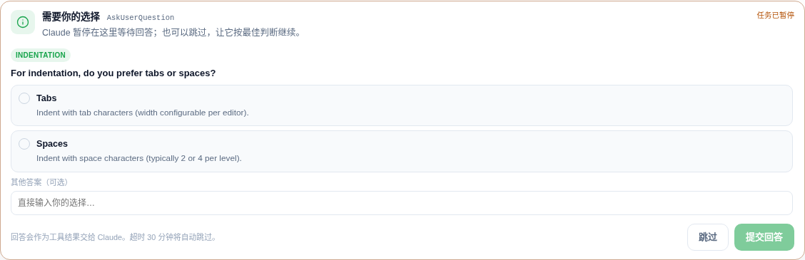

# UI 布局与交互决策

> 状态: current
> 最后核对: 2026-11-24
> 事实源: `web/src/styles.css`、`web/src/components/AppShell.vue`、`Home.vue`、`Chat.vue`
> 关联: [同类调研](COMPETITIVE-RESEARCH.md)

## 视觉方向

- 开发者控制台，而不是营销页：深色 slate + 单一绿色强调；亮色模式使用同一套 token。
- 不使用紫蓝渐变、发光、渐变文字、emoji 图标；图标为内联 SVG 描边。
- 字体使用系统栈；代码使用等宽字体；无外部字体/CDN。
- 动效仅用于状态（spinner、录音点、toast），尊重 `prefers-reduced-motion`。

## 布局

### 桌面（> 980px）

```text
┌───────────┬──────────────────────────────────────────────┐
│ 侧栏 276  │ 会话页：标题/统计 / 会话列表 + 新建会话面板   │
│ 新建会话  │ 聊天页：状态栏 / 消息流 / 审批 / 输入区       │
│ 最近会话  │                                              │
│ 设置/主题 │                                              │
└───────────┴──────────────────────────────────────────────┘
```

- 会话列表、Home 列表、搜索框均有明确职责：侧栏用于快速切换；Home 用于浏览与创建。
- 新建会话面板在 Home 右侧，桌面 sticky；手机端移到列表上方（`order: -1`）。
- 聊天内容最大宽度 900px，避免超宽屏阅读困难。

### 手机（≤ 980 / ≤ 720）

- 侧栏变为抽屉 + 遮罩；顶部 mobile bar 提供菜单、标题、新建。
- 聊天头只保留返回、标题、状态、模型/模式与设置；上下文条隐藏。
- 输入区贴底，工具栏只显示图标（命令/文件/附件/语音），保留发送主按钮。
- 审批面板在输入区上方，按钮等宽；默认拒绝项获得焦点（`defaultToNo` 时）。
- 统计卡在窄屏改为三列紧凑布局，避免把新建会话推到首屏之外。

## 入口审计（避免重复）

| 入口 | 位置 | 行为 | 是否重复 |
|---|---|---|---|
| 新建会话 | 侧栏主按钮 / 手机顶栏 + | 导航 Home 并滚动到创建面板 | 响应式等价，保留 |
| 新建会话 | Home 右侧/上方表单 | 实际创建 | 唯一创建表单 |
| 新建会话 | 聊天页顶栏 | 已移除 | 避免与侧栏重复 |
| 设置 | 侧栏底部 | 应用设置 | 不同层级 |
| 会话设置 | 聊天页顶栏齿轮 | 模式/模型/结束后台 | 不同层级 |
| 旁问 | 聊天页顶栏 chip / 主输入框 `/btw` | 打开浮动旁问面板 | 同一面板；命令是快捷别名，不重复实现 |
| 语音 | 输入区麦克风（直接听写）+ 设置页渠道卡片 | 使用 vs 配置 | 不同职责；不在聊天框重复配置 |
| 主题 | 侧栏快捷切换 + 设置页外观 | 同一状态 | 可接受，设置页负责发现 |

## 关键组件

- `AppShell`：侧栏、移动抽屉、会话轮询（20s）、主题、退出。
- `NewSessionPanel`：最近项目、目录浏览/新建文件夹、权限模式、模型、创建。
- `MessageItem`：用户气泡、Markdown、思考折叠、工具卡片、通知、回合元信息；流式思考的 260px 内层滚动区默认跟随到底部，用户手动上滚后不强制拉回。
- `ToolCard`：命令/ diff / 结果；错误自动展开；ANSI 输出。
- `PermissionPanel`：默认拒绝焦点、命令或 diff、三种决策。
- `QuestionPanel`：AskUserQuestion 的单选/多选问答卡；选项描述与可选预览、自由输入、跳过；提交把 `answers` 回传给 runtime。
- `PlanPanel`：ExitPlanMode 的计划确认卡；Markdown 计划正文、修改意见、批准并执行 / 继续完善计划。
- `VoiceControl`：单一麦克风按钮，直接开始/结束听写；任一首选实时渠道的 partial 经 `start/partial/text/end` 事件交给 Chat 实时替换输入框同一段文本；停止后忽略迟到 partial，按钮进入“处理中”，再点一次立即取消；错误走 toast。
- `VoiceSettings`：设置页内的渠道配置、密钥掩码、连接测试、预设；桌面与手机均可用，是唯一的语音配置入口。

### 交互确认面板

`AskUserQuestion` 与 `ExitPlanMode` 都固定在输入区上方，和审批面板同一层级；面板显示期间任务保持暂停，刷新后从 `session.state` 恢复。




## 输入区与停止（2026-11-24 优化）

参考同类项目（claudecodeui、Kanna、claude-run）的共同做法，输入区收敛为“一个输入框 + 一条底部工具栏”，不再把工具栏放在输入框上方：

```text
┌──────────────────────────────────────────────┐
│ [附件 chip / 图片缩略图]                      │
│ textarea                                     │
│ 命令  文件  附件  语音   Enter…  [停止] [发送] │
└──────────────────────────────────────────────┘
```

- 附件 chip 位于 textarea 上方：图片显示缩略图，其他文件显示名称/大小；上传中显示 spinner，可逐个移除。粘贴图片、拖拽文件与「附件」按钮走同一条上传链路；服务端如何接收与解析见 [附件链路](ATTACHMENTS.md)。
- 桌面保留提示文字 `Enter 发送 · Shift+Enter 换行 · Esc 停止`；手机隐藏提示、工具按钮只留图标，并保留 `env(safe-area-inset-bottom)`。
- 旁问入口固定在会话头部 chip，不占用输入区工具栏；主输入框输入 `/btw …` 也打开同一面板。浮动面板位于输入区上方，明确标注“当前上下文 · 不写入主对话”，单次回答显示费用与耗时。
- 旁问面板可拉伸：桌面右下浮动，手机底部全宽卡片；顶部 13–16px 的把手支持鼠标/触摸上下拖拽，向上增大高度，向下缩小；高度写入 `localStorage`（`cw.side.height`），双击还原为内容高度。桌面最大约 82dvh，手机约 78dvh，均限制在视口内；键盘 `↑/↓` 每次 24px、`Shift` 48px 调整，`Home` 最大、`End` 最小。冒烟覆盖 1280×900 与 390×844：拖拽、刷新恢复、双击还原、两端旁问均通过。
- 运行中发送的消息立即出现在聊天流里；用户气泡内显示「排队中，等待当前步骤结束」，回合边界自动消失，停止时显示「未送达」。
- 历史滚动到顶部自动加载更早消息，顶部按钮保留；首次载入按可渲染事件分页，不把 token 增量当消息显示。
- 运行中「停止」同时出现在顶部运行状态条和输入区底栏，手机上不依赖滚动到底部才能点到。
- 点击停止后立即进入“停止中…”：按钮 spinner + 禁用，服务端状态条显示“正在停止…”；超过 2.5 秒出现「强制结束」入口（结束后台进程并重新附着，聊天记录保留）。
- `Esc` 在没有候选菜单时停止当前回合；候选菜单打开时 `Esc` 仍只关闭菜单，避免误停。
- 服务端 interrupt 先拒绝挂起的权限请求再调用 SDK，避免“等待批准时点停止没反应”。实测活动 Bash 工具中断约 51ms 返回 idle。

## Diff 与代码块可读性（2026-11-23 优化）

- 亮色模式下，diff 的新增/删除行使用专门的 token，而不是 10% 透明度的 accent：
  - 新增：`#dcfce7` 背景 + `#16a34a` 左侧强调 + `#14532d` 文本；
  - 删除：`#fee2e2` 背景 + `#dc2626` 左侧强调 + `#7f1d1d` 文本。
- 暗色模式使用更高透明度的绿色/红色背景与浅色文本，保证在深色卡片上仍能区分。
- 工具卡边框改为 `border-strong`，亮色下加一层极轻阴影；命令/输出区加边框与正文色，避免“白底灰字”。
- 代码块补了 highlight.js 的 token 配色（关键字/字符串/数字/注释/标题），亮暗各一套；不额外引入主题 CSS 文件。
- diff 数据来自 Claude Code 的 `tool_use` 输入，不是服务端读文件；详见 [核心实现](IMPLEMENTATION.md#5-文件-diff-从哪里来)。

## 可访问性与细节

- `:focus-visible` 使用强调色描边；弹窗/面板不依赖 hover。
- 所有按钮有 `title` 或可见文本；图标按钮在移动端有足够点击面积。
- 颜色不作为唯一状态信号：状态同时有文字（运行中/等待批准/已停止）。
- 输入框、按钮、卡片在亮/暗两套 token 下都保持对比度。
- 关闭页面不会阻止用户；任务在服务端继续执行。
